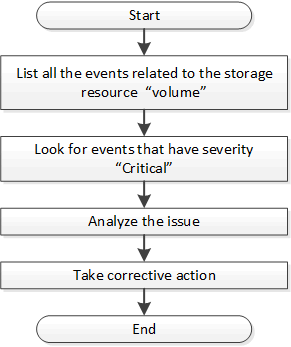

= Active IQ Unified Manager イベント API を使用してストレージオブジェクトの問題を特定する
:allow-uri-read: 
:icons: font
:imagesdir: ../media/

[role="lead"]
データセンター内のストレージオブジェクトがしきい値を超えると、そのイベントに関する通知が届きます。この通知を利用して問題を分析し、 `events` APIを使用して是正措置を講じることができます。

このワークフローでは、リソースオブジェクトとしてボリュームを例として取り上げます。 `events` APIを使用して、ボリュームに関連するイベントのリストを取得し、そのボリュームの重大な問題を分析して、問題を解決するための是正措置を実行できます。

修復手順を実行する前に、次の手順に従ってボリュームの問題を特定します。

.手順
. データセンター内のボリュームに対する重大なActive IQ Unified Managerイベント通知を分析します。
. /management-server/events API で以下のパラメータを使用して、ボリュームに関するすべてのイベントを照会します：
`"*resource_type": "volume*"`
`"*severity": "critical*"`
+
[cols="3*"]
|===
| カテゴリ | HTTP動詞 | パス 

 a| 
management-server
 a| 
GET
 a| 
/management-server/events

|===
. 出力を確認し、特定のボリュームの問題を分析します。
. Unified Manager REST APIまたはWeb UIを使用して必要な措置を講じ、問題を解決します。

