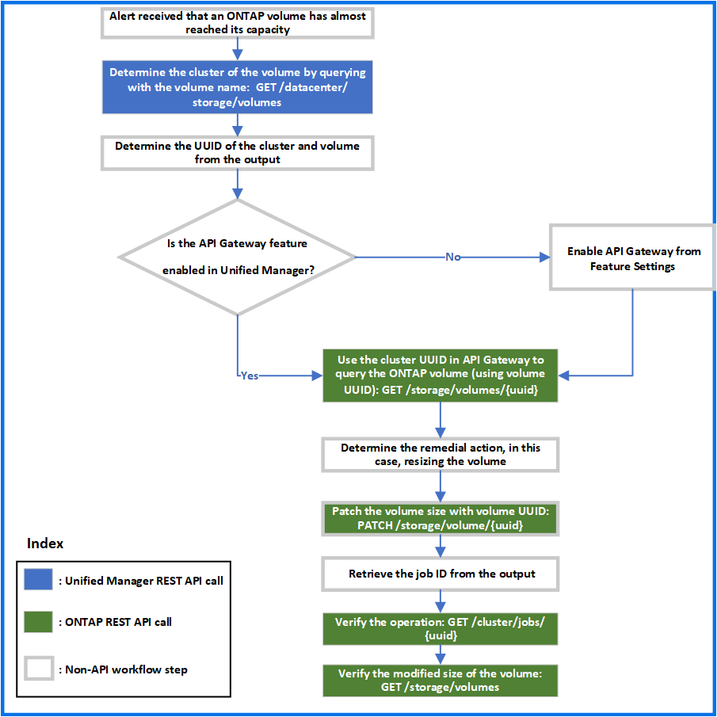

= Active IQ Unified Manager ゲートウェイ API を使用した ONTAP ボリュームのトラブルシューティング
:allow-uri-read: 
:icons: font
:imagesdir: ../media/

[role="lead"]
ゲートウェイAPIは、ONTAP APIを呼び出してONTAPストレージ オブジェクトに関する情報を照会し、修正策を実施して報告された問題に対処するためのゲートウェイとして機能します。

このワークフローでは、ONTAPボリュームの容量がほぼフルに達したときにイベントが生成されるユースケースを例に取り上げます。ワークフローには、Active IQ Unified ManagerとONTAPそれぞれのREST APIを呼び出してこの問題に対処する手順も含まれています。

[NOTE]
====
ワークフローの手順を実行する前に、次の点を確認してください。

* ゲートウェイAPIとその使用方法を理解している。詳細については、link:concept_gateway_apis.html["プロキシ アクセスによるONTAP APIへのアクセス"]を参照してください。
* ONTAP REST APIの使用方法を理解していること。ONTAP REST APIの使用方法については、https://docs.netapp.com/us-en/ontap-automation/index.html["ONTAP自動化に関するドキュメント"]を参照してください。
* アプリケーション管理者である。
* REST API処理を実行するクラスタがONTAP 9.5以降でサポートされており、HTTPSを使用してUnified Managerに追加されている。

====
次の図は、ONTAPボリュームの使用容量に関する問題をトラブルシューティングするためのワークフローの各手順を示したものです。

このワークフローには、Unified ManagerとONTAP両方のREST APIの呼び出しポイントが含まれています。

. ボリュームの使用容量を通知するイベントからボリューム名をメモします。
. ボリューム名をnameパラメータに指定し、次のUnified Manager APIを実行してボリュームを照会します。
+
[cols="3*"]
|===
| カテゴリ | HTTP動詞 | パス 

 a| 
datacenter
 a| 
GET
 a| 
`/datacenter/storage/volumes`

|===
. 出力からクラスタのUUIDとボリュームのUUIDを取得します。
. Unified Manager の Web UI で、*General* > *Feature Settings* > *API Gateway* に移動して、API Gateway 機能が有効になっているかどうかを確認します。この機能が有効になっていないと、gatewayカテゴリのAPIを呼び出すことはできません。無効になっている場合は有効にします。
. クラスターUUIDを使用して、APIゲートウェイ経由でONTAP API /`storage/volumes/{uuid}` を実行します。ボリュームUUIDがAPIパラメータとして渡されると、クエリはボリュームの詳細を返します。
+
APIゲートウェイを使用してONTAP APIを実行する場合、Unified Managerのクレデンシャルが内部で渡されて認証されます。このため、クラスタ アクセスのたびに認証手順を実行する必要はありません。

+
[cols="3*"]
|===
| カテゴリ | HTTP動詞 | パス 

 a| 
Unified Manager：gateway

ONTAP：storage
 a| 
GET
 a| 
ゲートウェイAPI： `/gateways/\{uuid}/\{path}`

ONTAP API： `/storage/volumes/\{uuid}`

|===
+
[NOTE]
====
/gateways/\{uuid}/\{path} では、\{uuid} の値をREST操作を実行するクラスタのUUIDに置き換える必要があります。\{path} は、ONTAP REST URL /storage/volumes/\{uuid} に置き換える必要があります。

====
+
追加されたURLは： `/gateways/\{cluster_uuid}/storage/volumes/\{volume_uuid}`

+
GET操作を実行すると、生成されるURLは次のようになります： `GEThttps://<hostname\>/api/gateways/<cluster_UUID\>/storage/volumes/\{volume_uuid\}`

+
*cURLコマンドの例*

+
[listing]
----
curl -X GET "https://<hostname>/api/gateways/1cd8a442-86d1-11e0-ae1c-9876567890123/storage/volumes/028baa66-41bd-11e9-81d5-00a0986138f7"
-H "accept: application/hal+json" -H "Authorization: Basic <Base64EncodedCredentials>"
----
. サイズ、使用量、および実施する修正策を出力から確認します。このワークフローでは、ボリュームのサイズを変更します。
. クラスタのUUIDを使用し、APIゲートウェイを使用して次のONTAP APIを実行し、ボリュームのサイズを変更します。ゲートウェイAPIとONTAP APIの入力パラメータについては、手順5を参照してください。
+
[cols="3*"]
|===
| カテゴリ | HTTP動詞 | パス 

 a| 
Unified Manager：gateway

ONTAP：storage
 a| 
PATCH
 a| 
ゲートウェイAPI： `/gateways/\{uuid}/\{path}`

ONTAP API： `/storage/volumes/\{uuid}`

|===
+
[NOTE]
====
クラスタUUIDとボリュームUUIDに加えて、ボリュームをサイズ変更するためのsizeパラメータの値を入力する必要があります。値は必ず_バイト単位_で入力してください。たとえば、ボリュームのサイズを100 GBから120 GBに増やす場合は、クエリの最後にsizeパラメータの値を入力します： `-d {\"size\": 128849018880}"`

====
+
*cURLコマンドの例*

+
[listing]
----
curl -X PATCH "https://<hostname>/api/gateways/1cd8a442-86d1-11e0-ae1c-9876567890123/storage/volumes/028baa66-41bd-11e9-81d5-00a0986138f7" -H
    "accept: application/hal+json" -H "Authorization: Basic <Base64EncodedCredentials>" -d
    {\"size\": 128849018880}"
----
+
JSON出力でジョブのUUIDが返されます。

. ジョブのUUIDを使用して、ジョブが正常に実行されたかどうかを確認します。クラスタのUUIDとジョブのUUIDを使用し、APIゲートウェイを使用して次のONTAP APIを実行します。ゲートウェイAPIとONTAP APIの入力パラメータについては、手順5を参照してください。
+
[cols="3*"]
|===
| カテゴリ | HTTP動詞 | パス 

 a| 
Unified Manager：gateway

ONTAP：cluster
 a| 
GET
 a| 
ゲートウェイAPI： `/gateways/\{uuid}/\{path}`

ONTAP API： `/cluster/jobs/\{uuid}`

|===
+
返されるHTTPコードは、ONTAP REST APIのHTTPステータス コードと同じです。

. 次のONTAP APIを実行して、サイズ変更後のボリュームの詳細を照会します。ゲートウェイAPIとONTAP APIの入力パラメータについては、手順5を参照してください。
+
[cols="3*"]
|===
| カテゴリ | HTTP動詞 | パス 

 a| 
Unified Manager：gateway

ONTAP：storage
 a| 
GET
 a| 
ゲートウェイAPI： `/gateways/\{uuid}/\{path}`

ONTAP API： `/storage/volumes/\{uuid}`

|===
+
出力には拡張後のボリューム サイズとして120GBと表示されます。

