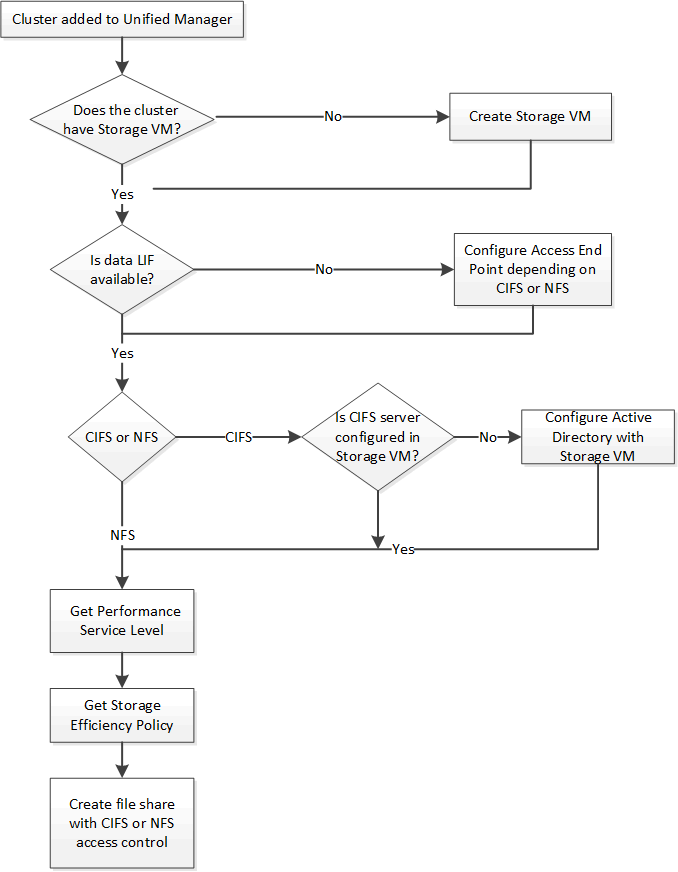

= Active IQ Unified Manager APIを使用してCIFSおよびNFSファイル共有をプロビジョニングする
:allow-uri-read: 
:icons: font
:imagesdir: ../media/

[role="lead"]
ストレージ仮想マシン（SVM）上に CIFS 共有と NFS ファイル共有をプロビジョニングするには、Active IQ Unified Manager の一部として提供されているプロビジョニング API を使用します。このプロビジョニングワークフローでは、ファイル共有を作成する前に、SVM、パフォーマンスサービスレベル、およびストレージ効率ポリシーのキーを取得する手順を詳しく説明します。

次の図は、ファイル共有のプロビジョニング ワークフローの各手順を示しています。ワークフローには、CIFS共有とNFSファイル共有の両方のプロビジョニングが含まれています。

[NOTE]
====
以下を確認してください。

* ONTAPクラスターがUnified Managerに追加され、クラスターキーが取得されました。
* クラスタにSVMが作成されている必要があります。
* SVMでCIFSサービスとNFSサービスがサポートされている必要があります。SVMで必要なサービスがサポートされていない場合、ファイル共有のプロビジョニングに失敗することがあります。
* FCPポートがポート プロビジョニング用にオンラインになっている必要があります。

====
. CIFS共有を作成するSVMで、データLIFまたはアクセス エンドポイントを使用できるかどうかを確認します。SVMで使用可能なアクセス エンドポイントのリストを取得します。
+
[cols="3*"]
|===
| カテゴリ | HTTP動詞 | パス 

 a| 
storage-provider
 a| 
GET
 a| 
`/storage-provider/access-endpoints`
`/storage-provider/access-endpoints/\{key}`

|===
+
*サンプルcURL*

+
[listing]
----
curl -X GET "https://<hostname>/api/storage-provider/access-endpoints?resource.key=7d5a59b3-953a-11e8-8857-00a098dcc959" -H "accept: application/json" -H "Authorization: Basic <Base64EncodedCredentials>"
----
. 使用するアクセス エンドポイントがリストに表示されている場合は、アクセス エンドポイント キーを取得します。表示されていない場合は、アクセス エンドポイントを作成します。
+
[NOTE]
====
CIFSプロトコルを有効にしてアクセス エンドポイントを作成してください。CIFSプロトコルを有効にしたアクセス エンドポイントを作成しないと、CIFS共有のプロビジョニングは失敗します。

====
+
[cols="3*"]
|===
| カテゴリ | HTTP動詞 | パス 

 a| 
storage-provider
 a| 
POST
 a| 
`/storage-provider/access-endpoints`

|===
+
*サンプルcURL*

+
作成するアクセス エンドポイントの詳細を、入力パラメータとして指定する必要があります。

+
[listing]
----
curl -X POST "https://<hostname>/api/storage-provider/access-endpoints" -H "accept: application/json" -H "Content-Type: application/json" -H "Authorization: Basic <Base64EncodedCredentials>"
{ \"data_protocols\": \"nfs\",
\"fileshare\": { \"key\": \"cbd1757b-0580-11e8-bd9d-00a098d39e12:type=volume,uuid=f3063d27-2c71-44e5-9a69-a3927c19c8fc\" },
\"gateway\": \"10.132.72.12\",
\"ip\": { \"address\": \"10.162.83.26\",
\"ha_address\": \"10.142.83.26\",
\"netmask\": \"255.255.0.0\" },
\"lun\": { \"key\": \"cbd1757b-0580-11e8-bd9d-00a098d39e12:type=lun,uuid=d208cc7d-80a3-4755-93d4-5db2c38f55a6\" },
\"mtu\": 15000, \"name\": \"aep1\",
\"svm\": { \"key\": \"cbd1757b-0580-11e8-bd9d-00a178d39e12:type=vserver,uuid=1d1c3198-fc57-11e8-99ca-00a098d38e12\" },
\"vlan\": 10}"
----
+
JSON出力にジョブ オブジェクト キーが表示され、作成したアクセス エンドポイントの検証に使用できます。

. アクセス エンドポイントを検証します。
+
[cols="3*"]
|===
| カテゴリ | HTTP動詞 | パス 

 a| 
management-server
 a| 
GET
 a| 
`/management-server/jobs/\{key}`

|===
. CIFS共有とNFSファイル共有のどちらを作成する必要があるかを判断します。CIFS共有を作成するには、次の手順を実行します。
+
.. SVMにCIFSサーバが設定されているかどうかを確認します。そのためには、SVMにActive Directoryマッピングが作成されているかどうかを特定します。
+
[cols="3*"]
|===
| カテゴリ | HTTP動詞 | パス 

 a| 
storage-provider
 a| 
GET
 a| 
`/storage-provider/active-directories-mappings`

|===
.. Active Directoryマッピングが作成されている場合は、キーを取得します。作成されていない場合は、SVMにActive Directoryマッピングを作成します。
+
[cols="3*"]
|===
| カテゴリ | HTTP動詞 | パス 

 a| 
storage-provider
 a| 
POST
 a| 
`/storage-provider/active-directories-mappings`

|===
+
*サンプルcURL*

+
Active Directoryマッピングを作成するための詳細を、入力パラメータとして指定する必要があります。

+
[listing]
----
curl -X POST "https://<hostname>/api/storage-provider/active-directories-mappings" -H "accept: application/json" -H "Content-Type: application/json" -H "Authorization: Basic <Base64EncodedCredentials>"
{ \"_links\": {},
\"dns\": \"10.000.000.000\",
\"domain\": \"example.com\",
\"password\": \"string\",
\"svm\": { \"key\": \"9f4ddea-e395-11e9-b660-005056a71be9:type=vserver,uuid=191a554a-f0ce-11e9-b660-005056a71be9\" },
\"username\": \"string\"}"
----
+
これは同期呼び出しであり、Active Directoryマッピングの作成を出力で確認できます。エラーが発生した場合はエラー メッセージが表示されるため、トラブルシューティングして要求を再実行します。

. 「クラスター上の SVM の検証」ワークフローのトピックで説明されているように、CIFS 共有または NFS ファイル共有を作成する SVM の SVM キーを取得します。
. 次のAPIを実行し、応答からパフォーマンス サービス レベルのキーを取得します。
+
[cols="3*"]
|===
| カテゴリ | HTTP動詞 | パス 

 a| 
storage-provider
 a| 
GET
 a| 
`/storage-provider/performance-service-levels`

|===
+
[NOTE]
====
システム定義のパフォーマンスサービスレベルの詳細を取得するには、 `system_defined`入力パラメータを `true`に設定します。出力結果から、ファイル共有に適用するパフォーマンスサービスレベルのキーを取得します。

====
. 必要に応じて、次のAPIを実行し、応答からファイル共有に適用するストレージ効率化ポリシーのキーを取得します。
+
[cols="3*"]
|===
| カテゴリ | HTTP動詞 | パス 

 a| 
storage-provider
 a| 
GET
 a| 
`/storage-provider/storage-efficiency-policies`

|===
. ファイル共有を作成します。アクセス制御リストとエクスポートポリシーを指定することで、CIFSとNFSの両方をサポートするファイル共有を作成できます。以下の手順では、ボリューム上のプロトコルのうち1つのみをサポートするファイル共有を作成する場合の情報を提供します。NFSファイル共有を作成した後でも、アクセス制御リストを含めるようにNFSファイル共有を更新することができます。詳細については、「ストレージワークロードの変更」のトピックを参照してください。
+
.. CIFS共有のみを作成する場合は、アクセス制御リスト（ACL）に関する情報を収集します。CIFS共有を作成するには、次の入力パラメータに有効な値を指定します。割り当てたユーザ グループごとに、CIFS共有またはSMB共有のプロビジョニング時にACLが作成されます。ACLおよびActive Directoryマッピングに入力した値に基づいて、CIFS共有の作成時にアクセス制御とマッピングが決定されます。
+
*サンプル値を含むcURLコマンド*

+
[listing]
----
{
  "access_control": {
    "acl": [
      {
        "permission": "read",
        "user_or_group": "everyone"
      }
    ],
    "active_directory_mapping": {
      "key": "3b648c1b-d965-03b7-20da-61b791a6263c"
    },
----
.. NFSファイル共有のみを作成する場合は、エクスポート ポリシーに関する情報を収集します。NFSファイル共有を作成するには、次の入力パラメータに有効な値を指定します。この値に基づいて、NFSファイル共有の作成時にエクスポート ポリシーが適用されます。
+
[NOTE]
====
NFS共有をプロビジョニングする際には、必要な値をすべて指定してエクスポートポリシーを作成するか、エクスポートポリシーキーを指定して既存のエクスポートポリシーを再利用することができます。ストレージVMのエクスポートポリシーを再利用する場合は、エクスポートポリシーキーを追加する必要があります。キーがわからない場合は、 `/datacenter/protocols/nfs/export-policies` APIを使用してエクスポートポリシーキーを取得できます。新しいポリシーを作成するには、以下のサンプルに示されているようにルールを入力する必要があります。入力されたルールに基づいて、APIはホスト、ストレージVM、およびルールを照合することにより、既存のエクスポートポリシーを検索します。既存のエクスポートポリシーがある場合は、そのポリシーが使用されます。そうでない場合は、新しいエクスポートポリシーが作成されます。

====
+
*サンプル値を含むcURLコマンド*

+
[listing]
----
"export_policy": {
      "key": "7d5a59b3-953a-11e8-8857-00a098dcc959:type=export_policy,uuid=1460288880641",
      "name_tag": "ExportPolicyNameTag",
      "rules": [
        {
          "clients": [
            {
              "match": "0.0.0.0/0"
            }
----

+
アクセス制御リストとエクスポート ポリシーを設定したら、CIFSとNFSファイル共有の両方に必須のパラメータに有効な値を入力します。

[NOTE]
====
ストレージ効率化ポリシーは、ファイル共有の作成ではオプションのパラメータです。

====
[cols="3*"]
|===
| カテゴリ | HTTP動詞 | パス 

 a| 
storage-provider
 a| 
POST
 a| 
`/storage-provider/file-shares`

|===
JSON出力にジョブ オブジェクト キーが表示され、作成したファイル共有の検証に使用できます。.ジョブの照会で返されたジョブ オブジェクト キーを使用して、ファイル共有の作成を確認します。

[cols="3*"]
|===
| カテゴリ | HTTP動詞 | パス 

 a| 
management-server
 a| 
GET
 a| 
`/management-server/jobs/\{key}`

|===
応答の末尾に、作成されたファイル共有のキーが表示されます。

[listing]
----

    ],
    "job_results": [
        {
            "name": "fileshareKey",
            "value": "7d5a59b3-953a-11e8-8857-00a098dcc959:type=volume,uuid=e581c23a-1037-11ea-ac5a-00a098dcc6b6"
        }
    ],
    "_links": {
        "self": {
            "href": "/api/management-server/jobs/06a6148bf9e862df:-2611856e:16e8d47e722:-7f87"
        }
    }
}
----
. 返されたキーを指定して次のAPIを実行し、ファイル共有の作成を確認します。
+
[cols="3*"]
|===
| カテゴリ | HTTP動詞 | パス 

 a| 
storage-provider
 a| 
GET
 a| 
`/storage-provider/file-shares/\{key}`

|===
+
*JSON出力例*

+
POST メソッドでは、 `/storage-provider/file-shares`内部的に各関数に必要なすべての API を呼び出し、オブジェクトを作成します。例えば、ファイル共有の Performance Service Level を割り当てるために `/storage-provider/performance-service-levels/` API を呼び出します。

+
[listing]
----
{
    "key": "7d5a59b3-953a-11e8-8857-00a098dcc959:type=volume,uuid=e581c23a-1037-11ea-ac5a-00a098dcc6b6",
    "name": "FileShare_377",
    "cluster": {
        "uuid": "7d5a59b3-953a-11e8-8857-00a098dcc959",
        "key": "7d5a59b3-953a-11e8-8857-00a098dcc959:type=cluster,uuid=7d5a59b3-953a-11e8-8857-00a098dcc959",
        "name": "AFFA300-206-68-70-72-74",
        "_links": {
            "self": {
                "href": "/api/datacenter/cluster/clusters/7d5a59b3-953a-11e8-8857-00a098dcc959:type=cluster,uuid=7d5a59b3-953a-11e8-8857-00a098dcc959"
            }
        }
    },
    "svm": {
        "uuid": "b106d7b1-51e9-11e9-8857-00a098dcc959",
        "key": "7d5a59b3-953a-11e8-8857-00a098dcc959:type=vserver,uuid=b106d7b1-51e9-11e9-8857-00a098dcc959",
        "name": "RRT_ritu_vs1",
        "_links": {
            "self": {
                "href": "/api/datacenter/svm/svms/7d5a59b3-953a-11e8-8857-00a098dcc959:type=vserver,uuid=b106d7b1-51e9-11e9-8857-00a098dcc959"
            }
        }
    },
    "assigned_performance_service_level": {
        "key": "1251e51b-069f-11ea-980d-fa163e82bbf2",
        "name": "Value",
        "peak_iops": 75,
        "expected_iops": 75,
        "_links": {
            "self": {
                "href": "/api/storage-provider/performance-service-levels/1251e51b-069f-11ea-980d-fa163e82bbf2"
            }
        }
    },
    "recommended_performance_service_level": {
        "key": null,
        "name": "Idle",
        "peak_iops": null,
        "expected_iops": null,
        "_links": {}
    },
    "space": {
        "size": 104857600
    },
    "assigned_storage_efficiency_policy": {
        "key": null,
        "name": "Unassigned",
        "_links": {}
    },
    "access_control": {
        "acl": [
            {
                "user_or_group": "everyone",
                "permission": "read"
            }
        ],
        "export_policy": {
            "id": 1460288880641,
            "key": "7d5a59b3-953a-11e8-8857-00a098dcc959:type=export_policy,uuid=1460288880641",
            "name": "default",
            "rules": [
                {
                    "anonymous_user": "65534",
                    "clients": [
                        {
                            "match": "0.0.0.0/0"
                        }
                    ],
                    "index": 1,
                    "protocols": [
                        "nfs3",
                        "nfs4"
                    ],
                    "ro_rule": [
                        "sys"
                    ],
                    "rw_rule": [
                        "sys"
                    ],
                    "superuser": [
                        "none"
                    ]
                },
                {
                    "anonymous_user": "65534",
                    "clients": [
                        {
                            "match": "0.0.0.0/0"
                        }
                    ],
                    "index": 2,
                    "protocols": [
                        "cifs"
                    ],
                    "ro_rule": [
                        "ntlm"
                    ],
                    "rw_rule": [
                        "ntlm"
                    ],
                    "superuser": [
                        "none"
                    ]
                }
            ],
            "_links": {
                "self": {
                    "href": "/api/datacenter/protocols/nfs/export-policies/7d5a59b3-953a-11e8-8857-00a098dcc959:type=export_policy,uuid=1460288880641"
                }
            }
        }
    },
    "_links": {
        "self": {
            "href": "/api/storage-provider/file-shares/7d5a59b3-953a-11e8-8857-00a098dcc959:type=volume,uuid=e581c23a-1037-11ea-ac5a-00a098dcc6b6"
        }
    }
}
----

