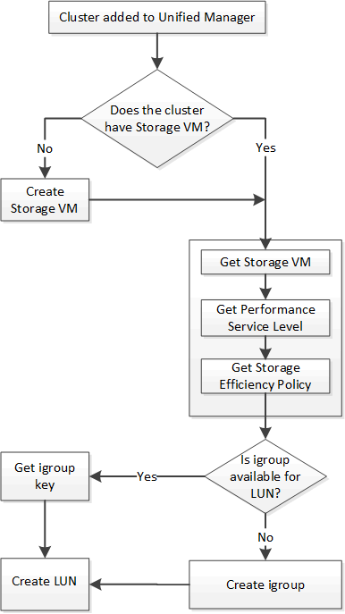

= Active IQ Unified Manager API を使用した LUN のプロビジョニング
:allow-uri-read: 
:icons: font
:imagesdir: ../media/

[role="lead"]
ストレージ仮想マシン（SVM）に LUN をプロビジョニングするには、Active IQ Unified Manager の一部として提供されるプロビジョニング API を使用します。このプロビジョニングワークフローでは、LUN を作成する前に、SVM、パフォーマンスサービスレベル、およびストレージ効率ポリシーのキーを取得する手順を詳しく説明します。

次の図は、LUNのプロビジョニング ワークフローの手順を示しています。

[NOTE]
====
このワークフローは、ONTAP クラスターが Unified Manager に追加され、クラスターキーが取得済みであることを前提としています。このワークフローでは、SVM がすでにクラスター上に作成されていることを前提としています。

====
. 「クラスタ上の SVM の検証」ワークフローのトピックで説明されている手順に従って、LUN を作成する SVM の SVM キーを取得します。
. 次のAPIを実行し、応答からパフォーマンス サービス レベルのキーを取得します。
+
[cols="3*"]
|===
| カテゴリ | HTTP動詞 | パス 

 a| 
storage-provider
 a| 
GET
 a| 
`/storage-provider/performance-service-levels`

|===
+
[NOTE]
====
システム定義のパフォーマンスサービスレベルの詳細を取得するには、 `system_defined`入力パラメータを `true`に設定します。出力結果から、LUNに適用するパフォーマンスサービスレベルのキーを取得します。

====
. 必要に応じて、次のAPIを実行し、応答からLUNに適用するストレージ効率化ポリシーのキーを取得します。
+
[cols="3*"]
|===
| カテゴリ | HTTP動詞 | パス 

 a| 
storage-provider
 a| 
GET
 a| 
`/storage-provider/storage-efficiency-policies`

|===
. 作成するLUNターゲットへのアクセスを付与するイニシエータ グループ（igroup）が作成されているかどうかを確認します。
+
[cols="3*"]
|===
| カテゴリ | HTTP動詞 | パス 

 a| 
datacenter
 a| 
GET
 a| 
`/datacenter/protocols/san/igroups`  `/datacenter/protocols/san/igroups/\{key}`

|===
+
igroupがアクセス権を有するSVMをパラメータ値として入力する必要があります。また、特定のigroupを照会する場合は、入力パラメータとしてigroup名（キー）を指定します。

. アクセスを付与するigroupが出力に見つかった場合は、そのキーを取得します。見つからない場合はigroupを作成します。
+
[cols="3*"]
|===
| カテゴリ | HTTP動詞 | パス 

 a| 
datacenter
 a| 
POST
 a| 
`/datacenter/protocols/san/igroups`

|===
+
作成するigroupの詳細を入力パラメータとして指定する必要があります。これは同期呼び出しであり、igroupの作成を出力で確認できます。エラーが発生した場合はエラー メッセージが表示されるため、トラブルシューティングしてAPIを再実行します。

. LUNを作成
+
[cols="3*"]
|===
| カテゴリ | HTTP動詞 | パス 

 a| 
storage-provider
 a| 
POST
 a| 
`/storage-provider/luns`

|===
+
LUNを作成する場合は、取得した値を必須パラメータとして指定する必要があります。

+
[NOTE]
====
ストレージ効率化ポリシーは、LUNの作成ではオプションのパラメータです。

====
+
*サンプルcURL*

+
作成するLUNのすべての詳細を入力パラメータとして指定する必要があります。

+
JSON出力にジョブ オブジェクト キーが表示され、作成したLUNの検証に使用できます。

. ジョブの照会で返されたジョブ オブジェクト キーを使用して、LUNの作成を確認します。
+
[cols="3*"]
|===
| カテゴリ | HTTP動詞 | パス 

 a| 
management-server
 a| 
GET
 a| 
`/management-server/jobs/\{key}`

|===
+
応答の末尾に、作成されたLUNのキーが表示されます。

. 返されたキーを指定して次のAPIを実行し、LUNの作成を確認します。
+
[cols="3*"]
|===
| カテゴリ | HTTP動詞 | パス 

 a| 
storage-provider
 a| 
GET
 a| 
`/storage-provider/luns/\{key}`

|===
+
*JSON出力例*

+
POST メソッドでは、 `/storage-provider/luns`内部的に各関数に必要なすべての API を呼び出し、オブジェクトを作成します。たとえば、LUN にパフォーマンスサービスレベルを割り当てるために `/storage-provider/performance-service-levels/` API を呼び出します。

+
== LUN の作成またはマッピングの失敗に関するトラブルシューティング手順

このワークフローを完了したあとも引き続きLUNの作成に失敗することがあります。LUNの作成に成功しても、LUNを作成したノードにSAN LIFまたはアクセス エンドポイントがないためにigroupとのLUNマッピングが失敗することがあります。エラーが発生した場合は、次のメッセージが表示されます。

[listing]
----
The nodes <node_name> and <partner_node_name> have no LIFs configured with the iSCSI or FCP protocol for Vserver <server_name>. Use the access-endpoints API to create a LIF for the LUN.
----
このエラーを回避するには、次のトラブルシューティング手順を実行します。

. LUNを作成しようとしたSVMに、ISCSI/FCPプロトコルをサポートするアクセス エンドポイントを作成します。
+
[cols="3*"]
|===
| カテゴリ | HTTP動詞 | パス 

 a| 
storage-provider
 a| 
POST
 a| 
`/storage-provider/access-endpoints`

|===
+
*サンプルcURL*

+
作成するアクセス エンドポイントの詳細を、入力パラメータとして指定する必要があります。

+
[NOTE]
====
入力パラメータに、LUNのホーム ノードを示すaddressと、ホーム ノードのパートナー ノードを示すha_addressを追加したことを確認します。この処理を実行すると、ホーム ノードとパートナー ノードの両方にアクセス エンドポイントが作成されます。

====
. JSON出力で返されたジョブ オブジェクト キーを使用してジョブを照会し、SVMにアクセス エンドポイントを追加するジョブが正常に実行されたこと、およびSVMでiSCSI/FCPサービスが有効になっていることを確認します。
+
[cols="3*"]
|===
| カテゴリ | HTTP動詞 | パス 

 a| 
management-server
 a| 
GET
 a| 
`/management-server/jobs/\{key}`

|===
+
*JSON出力例*

+
出力の最後に、作成されたアクセスエンドポイントのキーが表示されます。以下の出力では、「name」：「accessEndpointKey」の値は、LUNのホームノード上に作成されたアクセスエンドポイントを示しており、そのキーは9c964258-14ef-11ea-95e2-00a098e32c28です。「name」：「accessEndpointHAKey」の値は、ホームノードのパートナーノード上に作成されたアクセスエンドポイントを示しており、そのキーは9d347006-14ef-11ea-8760-00a098e3215fです。

. LUNを変更してigroupマッピングを更新します。ワークフローの変更に関する詳細については、「`Modifying storage workloads`」を参照してください。
+
[cols="3*"]
|===
| カテゴリ | HTTP動詞 | パス 

 a| 
storage-provider
 a| 
PATCH
 a| 
`/storage-provider/lun/\{key}`

|===
+
入力で、LUNマッピングの更新に使用するigroupキーと、LUNキーを指定します。

+
*サンプルcURL*

+
JSON出力にジョブ オブジェクト キーが表示され、マッピングが成功したかどうかの検証に使用できます。

. LUNキーを指定して照会することで、LUNマッピングを確認します。
+
[cols="3*"]
|===
| カテゴリ | HTTP動詞 | パス 

 a| 
storage-provider
 a| 
GET
 a| 
`/storage-provider/luns/\{key}`

|===
+
*JSON出力例*

+
出力から、LUNのプロビジョニング時に使用されたigroup（キーd19ec2fa-fec7-11e8-b23d-00a098e32c28）にLUNが正常にマッピングされていることがわかります。

