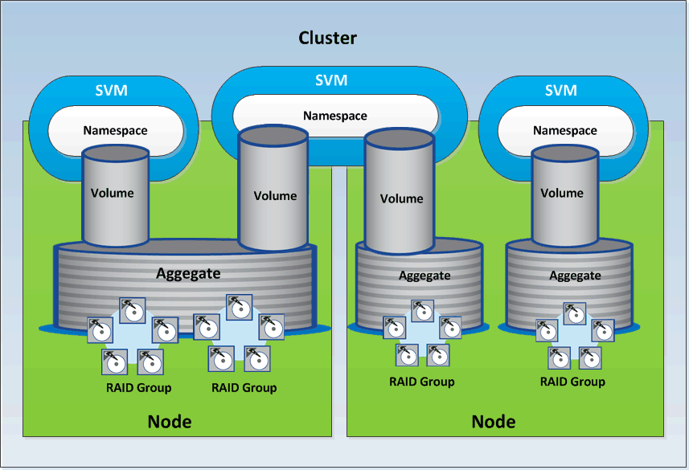

= Active IQ Unified Manager の ONTAP ストレージリソースモデルについて
:allow-uri-read: 
:icons: font
:imagesdir: ../media/

[role="lead"]
ONTAPのストレージリソースは、大きく分けて_物理ストレージリソース_と_論理ストレージリソース_に分類できます。Active IQ Unified Managerで提供されるAPIを使用してONTAPシステムを効果的に管理するには、ストレージリソースモデルと、さまざまなストレージリソース間の関係を理解する必要があります。

* *物理的なストレージリソース*
+
ONTAPが提供する物理ストレージ オブジェクトのことです。物理ストレージ リソースには、ディスク、クラスタ、ストレージ コントローラ、ノード、およびアグリゲートがあります。

* 論理ストレージリソース
+
物理リソースに関連付けられていない、ONTAPが提供するストレージ リソースのことです。これらのリソースはStorage Virtual Machine（SVM、旧Vserver）に関連付けられていて、ディスク、アレイLUN、アグリゲートなどの特定の物理ストレージ リソースには紐づけられていません。

+
論理ストレージ リソースには、すべてのタイプのボリュームとqtreeだけでなく、Snapshotコピー、重複排除、圧縮、クォータなど、これらのリソースで使用できる機能および設定も含まれます。

次の図は、2ノード クラスタのストレージ リソースを示しています。

