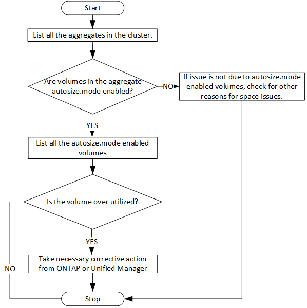

= Active IQ Unified Manager API を使用してアグリゲートのスペースの問題を特定する
:allow-uri-read: 
:icons: font
:imagesdir: ../media/

[role="lead"]
Active IQ Unified ManagerのデータセンターAPIを使用して、ボリューム内のスペースの可用性と使用率を監視できます。ボリューム内のスペースの問題を特定し、使用率が高すぎる、または十分に活用されていないストレージ リソースを特定できます。

アグリゲート用のデータセンターAPIは、使用可能スペースや使用済みスペース、スペース削減のための効率化設定などの関連情報を取得します。また、指定した属性に基づいて取得した情報をフィルタすることもできます。

アグリゲートにスペースが不足しているかどうかを確認する方法の1つとして、環境内にオートサイズ モードが有効なボリュームがあるかを確認する方法があります。次に、使用率が高すぎるボリュームを特定し、対処策を実行する必要があります。

次のフローチャートは、オートサイズ モードが有効なボリュームに関する情報を取得するプロセスを示しています。

このフローは、クラスタがONTAPですでに作成され、Unified Managerに追加されていることを前提としています。

. クラスタ キーの値がわからない場合は取得します。
+
[cols="3*"]
|===
| カテゴリ | HTTP動詞 | パス 

 a| 
datacenter
 a| 
GET
 a| 
`/datacenter/cluster/clusters`

|===
. クラスタ キーをフィルタ パラメータとして使用して、そのクラスタのアグリゲートを照会します。
+
[cols="3*"]
|===
| カテゴリ | HTTP動詞 | パス 

 a| 
datacenter
 a| 
GET
 a| 
`/datacenter/storage/aggregates`

|===
. 応答から、アグリゲートのスペース使用量を分析し、スペースに問題があるアグリゲートを特定します。スペースに問題がある各アグリゲートについて、同じJSON出力からアグリゲート キーを取得します。
. 各アグリゲートキーを使用して、autosize.mode パラメーターの値が `grow.`であるすべてのボリュームをフィルタリングします
+
[cols="3*"]
|===
| カテゴリ | HTTP動詞 | パス 

 a| 
datacenter
 a| 
GET
 a| 
`/datacenter/storage/volumes`

|===
. 使用率が高いボリュームを分析します。
. ボリューム内のスペースの問題を解決するために、ボリュームをアグリゲート間で移動するなどの必要な対処策を実行します。これらの処理は、ONTAPまたはUnified Manager Web UIから実行できます。

