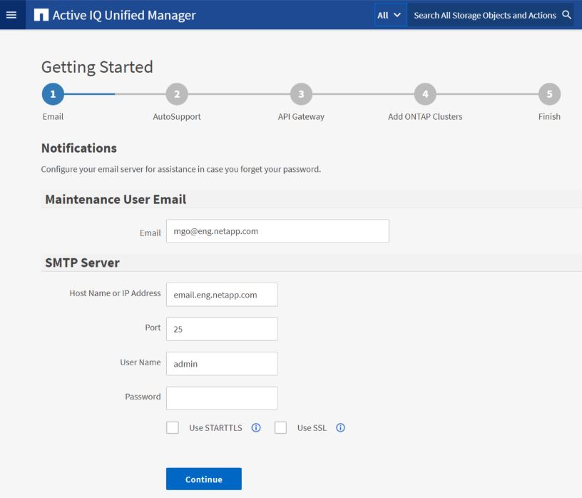

= Active IQ Unified Manager ウェブ UI の初期設定を実行する
:allow-uri-read: 
:icons: font
:imagesdir: ../media/

[role="lead"]
Unified Managerを使用するには、NTPサーバ、メンテナンス ユーザのEメール アドレス、SMTPサーバのホストなどを最初に設定し、ONTAPクラスタを追加する必要があります。

.開始する前に
次の作業を完了しておきます。

* インストールの完了時に表示されたURLを使用してUnified Manager Web UIを起動します。
* インストール時に作成したメンテナンス ユーザ（Linux環境の場合はumadminユーザ）の名前とパスワードを使用してログインします。

Active IQ Unified Managerの[はじめに]ページは、Web UIへの初回アクセス時にのみ表示されます。次のページはVMware環境の場合の例を示したものです。

これらのオプションをあとで変更する場合は、Unified Managerの左側のナビゲーション ペインの[全般]オプションから選択できます。NTP設定はVMware専用です。この設定はあとからUnified Managerメンテナンス コンソールを使用して変更できます。

.手順
. Active IQ Unified Manager の初期設定ページで、メンテナンスユーザーのメールアドレス、SMTP サーバーのホスト名、その他の SMTP オプション、および NTP サーバー（VMware インストールの場合のみ）を入力します。次に「続行」をクリックします。
+
[NOTE]
====
*STARTTLSを使用する*または*SSLを使用する*オプションを選択した場合、*続行*ボタンをクリックすると証明書ページが表示されます。証明書の詳細を確認し、証明書を承認して、Web UIの初期設定を続行してください。

====
. AutoSupport ページで *[Agree and Continue]* をクリックして、Unified Manager から NetAppActive IQ への AutoSupport メッセージの送信を有効にします。
+
インターネットアクセスを提供するためにプロキシを指定して AutoSupport コンテンツを送信する必要がある場合、または AutoSupport を無効にする場合は、Web UI から *General* > *AutoSupport* オプションを使用してください。

. Red Hat システムでは、umadmin ユーザーのパスワードをデフォルトの「`admin`」文字列から、独自の文字列に変更してください。
. [APIゲートウェイのセットアップ]ページで、監視対象のONTAPクラスタをUnified ManagerでONTAP REST APIを使用して管理できるようにAPIゲートウェイ機能を使用するかどうかを選択します。次に「続行」をクリックします。
+
この設定は、Web UI の「一般」>「機能設定」>「API ゲートウェイ」から後で有効または無効にできます。API の詳細については、link:../api-automation/concept_get_started_with_um_apis.html["Active IQ Unified Manager REST APIでの作業の開始"]を参照してください。

. Unified Managerで管理するクラスターを追加し、「次へ」をクリックします。管理する各クラスターについて、ホスト名またはクラスター管理IPアドレス（IPv4またはIPv6）と、ユーザー名およびパスワードの認証情報が必要です。ユーザーは「`admin`」ロールを持っている必要があります。
+
この手順は任意です。クラスターは、Web UI の「ストレージ管理」>「クラスター設定」から後から追加できます。

. 概要ページで、すべての設定が正しいことを確認し、*完了*をクリックします。

[はじめに]ページが閉じ、Unified Managerの[ダッシュボード]ページが表示されます。
