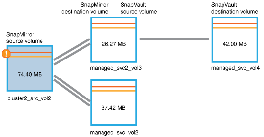

= Active IQ Unified Manager で失敗した保護ジョブの問題を特定し、是正措置を実行します
:allow-uri-read: 
:icons: font
:imagesdir: ../media/

[role="lead"]
ジョブの失敗に関するエラー メッセージを[イベントの詳細]ページの[原因]フィールドで確認し、ジョブが失敗した原因がSnapshotコピー エラーであることを特定します。次に、[ボリューム / 健全性の詳細]ページに移動して詳細情報を収集します。

.開始する前に
アプリケーション管理者のロールが必要です。

[イベントの詳細]ページの[原因]フィールドに表示されるエラー メッセージには、失敗したジョブに関する次のテキストが記載されています。

[listing]
----
Protection Job Failed. Reason: (Transfer operation for
relationship 'cluster2_src_svm:cluster2_src_vol2->cluster3_dst_svm:
managed_svc2_vol3' ended unsuccessfully. Last error reported by
Data ONTAP: Failed to create Snapshot copy 0426cluster2_src_vol2snap
on volume cluster2_src_svm:cluster2_src_vol2. (CSM: An operation
failed due to an ONC RPC failure.)
Job Details
----
このメッセージから得られる情報は次のとおりです。

* バックアップ ジョブまたはミラー ジョブが正常に完了しなかった。
+
このジョブには、仮想サーバー `cluster2_src_svm`上のソース ボリューム `cluster2_src_vol2`と、仮想サーバー「 `cluster3_dst_svm`」上のデスティネーション ボリューム `managed_svc2_vol3`との間の保護関係が含まれていました。

* スナップショット コピー ジョブが `0426cluster2_src_vol2snap`のソース ボリューム `cluster2_src_svm:/cluster2_src_vol2`で失敗しました。

このシナリオでは、ジョブが失敗した原因と考えられる対処策を特定できます。ただし、失敗を解決するには、System Manager Web UIまたはONTAP CLIコマンドを使用する必要があります。

.手順
. エラー メッセージを確認し、ソース ボリュームでSnapshotコピー ジョブが失敗していることから、おそらくソース ボリュームに問題があると判断します。
+
必要に応じて、エラーメッセージの末尾にある *Job Details* リンクをクリックすることもできますが、このシナリオでは、クリックしないことを選択します。

. イベントを解決するために、次の作業を行います。
+
.. *「割り当て先」*ボタンをクリックし、メニューから*「自分」*を選択してください。
.. イベントに対してアラートが設定されている場合は、繰り返しアラート通知を受け取らないように、*承認*ボタンをクリックしてください。
.. 必要に応じて、イベントに関するメモを追加することもできます。

. ソースボリュームの詳細を表示するには、*概要*ペインの*ソース*フィールドをクリックします。
+
「ソース」フィールドには、ソースオブジェクトの名前が含まれます。この場合、Snapshot コピージョブがスケジュールされたボリュームの名前です。

+
ボリューム / ヘルスの詳細ページが `cluster2_src_vol2`に表示され、「保護」タブの内容が表示されます。

. 保護トポロジ グラフを見ると、トポロジの最初のボリューム（SnapMirror関係のソース ボリューム）にエラー アイコンが関連付けられています。
+
また、そのボリュームに設定されている警告とエラーのしきい値を示す水平のバーが、ソース ボリューム アイコンに表示されています。

+

. エラー アイコンにカーソルを合わせると、ポップアップ ダイアログが開いてしきい値の設定が表示され、ボリュームがエラーしきい値を超えて容量の問題が発生していることがわかります。
. 「容量」タブをクリックします。
+
ボリュームの容量に関する情報 `cluster2_src_vol2`が表示されます。

. *容量*パネルを見ると、棒グラフにエラーアイコンが表示されています。これは、ボリューム容量がボリュームに設定されたしきい値を超えたことを示しています。
. 容量グラフの下には、ボリュームの自動拡張が無効になっていることと、ボリュームのスペース ギャランティが設定されていることが示されています。
+
自動拡張を有効にすることもできますが、このシナリオの目的上、さらに調査を進めてから、容量の問題を解決する方法を決定することにします。

. 「イベント」リストまでスクロールすると、「保護ジョブの失敗」、「ボリュームがいっぱいになるまでの日数」、「ボリュームの空き容量がいっぱい」というイベントが生成されていることがわかります。
. 「イベント」リストで、「ボリューム容量がいっぱい」イベントをクリックして詳細情報を取得します。これは、このイベントが容量の問題に最も関連していると判断したためです。
+
[イベントの詳細]ページには、ソース ボリュームに対して「ボリューム スペースがフル」イベントが表示されています。

. 「概要」エリアで、イベントの原因フィールドを確認します： `The full threshold set at 90% is breached. 45.38 MB (95.54%) of 47.50 MB is used`。
. [サマリ]領域の下の[推奨される対処方法]に、推奨される対処策が表示されます。
+
[TIP]
====
[推奨される対処方法]は一部のイベントだけに表示されるため、どのタイプのイベントでもこの領域が表示されるわけではありません。

====
+
「ボリューム スペースがフル」イベントを解決するために実施する推奨対処策をクリックしていきます。

+
** このボリュームで自動拡張を有効にします。
** ボリュームのサイズを変更する。
** このボリュームで重複排除を有効にして実行してください。
** このボリュームで圧縮を有効にして実行します。

. ボリュームの自動拡張を有効にすることにしましたが、これを行うには、親アグリゲート上の空きスペースと現在のボリューム増加率を確認する必要があります。
+
.. 親アグリゲート（ `cluster2_src_aggr1`）を「関連デバイス」ペインで確認します。
+
[TIP]
====
アグリゲートの名前をクリックすると、アグリゲートに関する詳細情報を参照できます。

====
+
ボリュームに自動拡張を有効にするための十分なスペースがあることを確認します。

.. ページ上部に重要なインシデントを示すアイコンが表示されるので、アイコンの下のテキストを確認します。
+
「Days to Full: 1日未満 | Daily Growth Rate: 5.4%」と判断します。

. System Manager に移動するか、ONTAP CLI にアクセスして `volume autogrow`オプションを有効にします。
+
[TIP]
====
ボリュームとアグリゲートの名前をメモしておいて、自動拡張を有効にするときに参照できるようにします。

====
. 容量の問題を解決したあと、Unified Managerの*イベント*詳細ページに戻り、イベントを解決済みとしてマークしてください。

