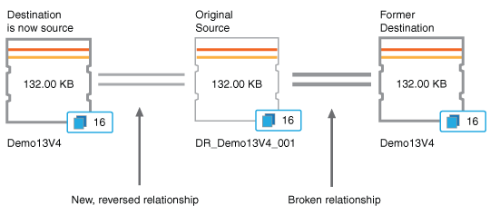

= Active IQ Unified Manager で保護関係のフェイルオーバーとフェイルバックを実行する
:allow-uri-read: 
:icons: font
:imagesdir: ../media/

[role="lead"]
ハードウェア障害や災害が原因で保護関係のソース ボリュームが無効になっている場合は、Unified Managerの保護関係機能を使用して、保護デスティネーションに読み取り / 書き込みアクセスを設定し、ソースが再びオンラインになるまでそのボリュームにフェイルオーバーすることができます。さらに、元のソースがデータを提供できるようになった時点で、ソースにフェイルバックすることができます。

.開始する前に
* アプリケーション管理者またはストレージ管理者のロールが必要です。
* この処理を実行するには、OnCommand Workflow Automationをセットアップしておく必要があります。

.手順
. link:task_break_snapmirror_relationship_from_health_volume_details.html["SnapMirror関係の解除"]。
+
デスティネーションをデータ保護ボリュームから読み取り / 書き込みボリュームに変換する前、および関係を反転する前に、関係を解除する必要があります。

. link:task_reverse_protection_relationships_from_health_volume_details.html["保護関係を逆転させる"]。
+
元のソース ボリュームが再び使用可能になったら、ソース ボリュームをリストアして元の保護関係を再確立できます。ソースをリストアする前に、以前のデスティネーションに書き込まれたデータとソースを同期させる必要があります。逆再同期処理を使用して新しい保護関係を作成するには、元の関係のロールを反転し、ソース ボリュームと以前のデスティネーションを同期させます。新しい関係に対して新しいベースラインSnapshotコピーが作成されます。

+
反転関係は、カスケード関係に似ています。

+

. link:task_break_snapmirror_relationship_from_health_volume_details.html["反転されたSnapMirror関係をブレイクします"]。
+
元のソース ボリュームが再同期され、再びデータを提供できるようになったら、解除処理を使用して反転関係を解除します。

. link:task_remove_protection_relationship_voldtls.html["関係を削除する"]。
+
反転関係が不要になったときは、元の関係を再確立する前に反転関係を削除する必要があります。

. link:task_resynchronize_protection_relationships_voldtls.html["関係を再同期する"]。
+
再同期処理を使用して、ソースからデスティネーションにデータを同期し、元の関係を再確立します。

