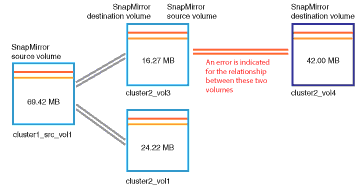

= Active IQ Unified Manager でのラグの問題を解決する
:allow-uri-read: 
:icons: font
:imagesdir: ../media/

[role="lead"]
このワークフローでは、遅延の問題を解決する方法の例を示します。このシナリオでは、管理者またはオペレータが、Unified Managerの[ダッシュボード]ページにアクセスして保護関係に問題がないかどうかを確認し、問題がある場合は解決策を探します。

.開始する前に
アプリケーション管理者またはストレージ管理者のロールが必要です。

[ダッシュボード]ページで、[未解決のインシデントとリスク]領域を参照すると、[保護]ペインの[保護のリスク]の下にSnapMirror遅延エラーが表示されています。

.手順
. *ダッシュボード*ページの*保護*ペインで、SnapMirror関係の遅延エラーを見つけてクリックします。
+
遅延エラー イベントの[イベントの詳細]ページが表示されます。

. *イベント* の詳細ページから、以下のタスクを1つ以上実行できます。
+
** 概要エリアの原因フィールドにあるエラーメッセージを確認し、推奨される是正措置があるかどうかを判断してください。
** ボリュームの詳細を表示するには、概要領域の「ソース」フィールドにあるオブジェクト名（この場合はボリューム）をクリックします。
** このイベントに関して追加されたメモを確認します。
** イベントにメモを追加します。
** イベントを特定のユーザに割り当てます。
** イベントに応答するか、またはイベントを解決します。

. このシナリオでは、ボリュームの詳細を取得するために、「概要」領域の「ソース」フィールドにあるオブジェクト名（この場合はボリューム）をクリックします。
+
[ボリューム / 健全性の詳細]ページの[保護]タブが表示されます。

. 「保護」タブでは、トポロジー図を確認できます。
+
3つのボリュームで構成されるSnapMirrorカスケードの最後のボリュームで遅延エラーが発生していることがわかりました。選択したボリュームがダークグレーの線で囲まれます。ソース ボリュームから延びるオレンジ色の二重線は、SnapMirror関係のエラーを示しています。

+

. SnapMirrorカスケード内の各ボリュームをクリックします。
+
別のボリュームを選択すると、[Summary]、[Topology]、[History]、[Events]、[Related Devices]、[Related Alerts]の各領域に表示される保護情報が、そのボリュームに関連する詳細情報に変わります。

. 「概要」エリアを確認し、各ボリュームの「更新スケジュール」フィールドにある情報アイコンにカーソルを合わせます。
+
このシナリオでは、SnapMirrorポリシーがDPDefaultであり、SnapMirrorスケジュールが毎時5分に更新されます。関係内のすべてのボリュームが同時にSnapMirror転送を試行することがわかりました。

. 遅延の問題を解決するには、カスケードされたボリュームのうちの2つのスケジュールを変更して、ソースが転送を完了してからデスティネーションがSnapMirror転送を開始するようにします。

