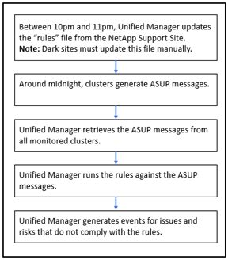

= Active IQ Unified Manager が Active IQ プラットフォームイベントを生成する仕組み
:allow-uri-read: 
:icons: font
:imagesdir: ../media/

[role="lead"]
Active IQプラットフォームのインシデントとリスクは、次の流れでUnified Managerのイベントに変換されます。

このフロー図からわかるように、Active IQプラットフォームで作成されたルール ファイルが最新の状態に維持され、クラスタのAutoSupportメッセージが毎日生成され、Unified Managerがイベントのリストを毎日更新します。
