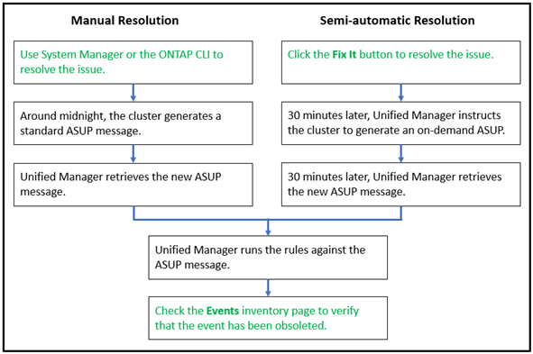

= Active IQ Unified Manager で Active IQ プラットフォームイベントを解決する
:allow-uri-read: 
:icons: font
:imagesdir: ../media/

[role="lead"]
Active IQプラットフォームのインシデントとリスクは、他のUnified Managerイベントと同様に他のユーザにその解決を割り当てることができ、ステータスの種類も同じです。ただし、「Fix It」ボタンを使用してこれらの種類のイベントを解決すると、数時間以内に解決状況を確認できます。

次の図は、Active IQプラットフォームから生成されたイベントの解決時にユーザが実行する操作（緑）とUnified Managerで実行される操作（黒）を示しています。

手動で解決する場合は、System ManagerまたはONTAPコマンドライン インターフェイスにログインして問題を解決する必要があります。この場合、問題の解決を確認できるのは、午前0時にクラスタで新しいAutoSupportメッセージが生成されたあとです。

「Fix It」ボタンを使用して半自動的な解決を実行すると、数時間以内に修正が成功したことを確認できます。
