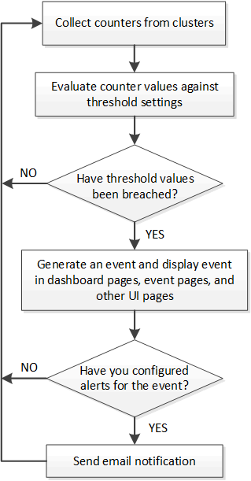

= Active IQ Unified Manager が受信したイベントを処理する方法を理解する
:allow-uri-read: 
:icons: font
:imagesdir: ../media/

[role="lead"]
Unified Managerで受信したイベントは、[ダッシュボード]ページ、[イベント管理]インベントリ ページ、[クラスタ / パフォーマンス]ページの[サマリ]タブと[エクスプローラ]タブ、およびオブジェクトごとのインベントリ ページ（[ボリューム / 健全性]インベントリ ページなど）に表示されます。

Unified Manager は、同じクラスタ コンポーネントに対して同じイベント条件が複数回連続して発生したことを検出した場合、それらを個別のイベントとしてではなく、単一のイベントとして扱います。イベントの継続時間は、イベントがまだ進行中であることを示すために増加します。

[アラート セットアップ]ページの設定に応じて、イベントを他のユーザに通知することができます。アラートにより、次の処理が開始されます。

* イベントに関するメールは、すべての Unified Manager 管理者ユーザーに送信できます。
* イベントを追加のEメール受信者に送信できます。
* SNMPトラップをトラップ レシーバに送信できます。
* 処理を実行するカスタム スクリプトを実行できます。

このワークフローを次の図に示します。

