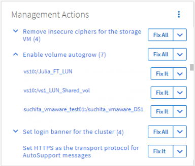

= Active IQ Unified Manager の自動修復を使用して問題を修正する
:allow-uri-read: 
:icons: font
:imagesdir: ../media/

[role="lead"]
Unified Managerは、特定のイベントを徹底的に診断し、*Fix It*ボタンを使用して単一の解決策を提供することができます。利用可能な場合、これらの解決策はダッシュボード、イベント詳細ページ、および左側のナビゲーションメニューのワークロード分析選択画面に表示されます。

ほとんどのイベントにはさまざまな解決策があり、イベントの詳細ページに表示されるため、ONTAP System ManagerまたはONTAP CLIを使用して最適な解決策を実行できます。Unified Managerが、問題を解決するための解決策が1つだけであり、ONTAP CLIコマンドを使用して解決できると判断した場合、*Fix It*アクションが利用可能になります。

.手順
. *Dashboard* から修正可能なイベントを表示するには、*Dashboard* をクリックします。
+

. Unified Managerで解決できる問題に対処するには、*Fix It*ボタンをクリックします。複数のオブジェクトに存在する問題を修正するには、*Fix All*ボタンをクリックします。

自動修復で解決できる問題については、link:..//storage-mgmt/reference_what_ontap_issues_can_unified_manager_fix.html["Unified Managerで解決可能な問題"]を参照してください。
