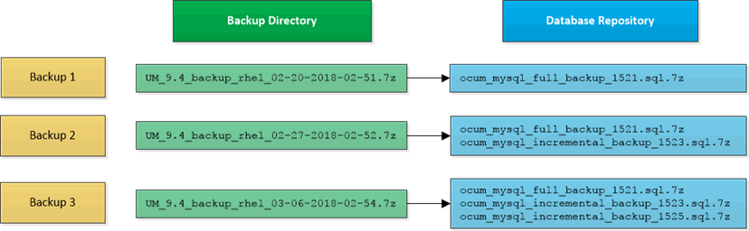

= Active IQ Unified Manager でのMySQLデータベースダンプを使用したバックアップと復元
:allow-uri-read: 
:icons: font
:imagesdir: ../media/

[role="lead"]
MySQL データベース ダンプ バックアップとは、システム障害やデータ損失が発生した場合に利用できるActive IQ Unified Managerデータベースと構成ファイルのコピーです。バックアップはローカルにもリモートにも保存できますが、Active IQ Unified Managerホスト システムとは別のリモートの場所を定義することを推奨します。

[NOTE]
====
LinuxサーバおよびWindowsサーバにUnified Managerをインストールしている場合、デフォルトのバックアップ メカニズムはMySQLデータベース ダンプです。ただし、Unified Managerで管理しているクラスタやノードの数が多い場合や、MySQLバックアップが完了するまでに何時間もかかる場合は、Snapshotコピーを使用してバックアップを実行できます。この機能は、Red Hat Enterprise LinuxおよびWindowsで使用できます。

====
データベース ダンプ バックアップでは、バックアップ ディレクトリに1つのファイルとデータベース リポジトリ ディレクトリに1つ以上のファイルが作成されます。バックアップ ディレクトリ内のファイルは非常に小さく、バックアップを再作成するために必要なデータベース リポジトリ ディレクトリ内のファイルへのポインタのみが含まれます。

データベース バックアップの初回生成時は、バックアップ ディレクトリに1つのファイルが作成され、データベース リポジトリ ディレクトリにフル バックアップ ファイルが作成されます。それ以降のバックアップの生成時は、バックアップ ディレクトリに1つのファイルが作成され、データベース リポジトリ ディレクトリにフル バックアップ ファイルとの差分を含む増分バックアップ ファイルが作成されます。追加のバックアップを作成すると、次の図に示すように、最大保持設定までこのプロセスが繰り返されます。

[NOTE]
====
これらの2つのディレクトリ内のバックアップ ファイルは、名前を変更したり削除したりしないでください。それらの処理を行うと、以降のリストア処理が失敗します。

====
バックアップ ファイルをローカル システムに保存する場合は、完全なリストアを必要とするシステムの問題が発生したときに使用できるように、それらのバックアップ ファイルをリモートにコピーする処理が必要になります。

バックアップ処理を開始する前に、Active IQ Unified Managerで整合性チェックが実行され、必要なすべてのバックアップ ファイルとバックアップ ディレクトリが存在し、書き込み可能であることが確認されます。また、バックアップ ファイルを作成できるだけの十分なスペースがシステムにあるかどうかも確認されます。
