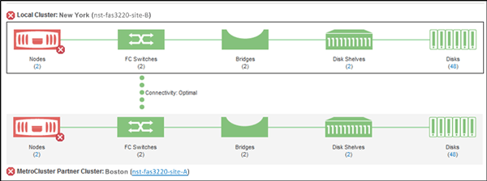
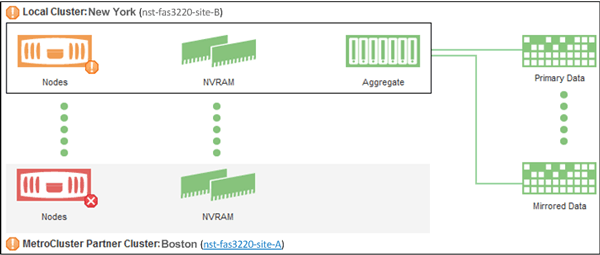

= Active IQ Unified Manager で MetroCluster 構成のクラスターの健全性を確認する
:allow-uri-read: 
:icons: font
:imagesdir: ../media/

[role="lead"]
Active IQ Unified Manager（Unified Manager）を使用して、MetroCluster over FC構成およびMetroCluster over IP構成のクラスタとそのコンポーネントについて、健全性を確認することができます。Unified Managerによって検出されたパフォーマンス イベントにクラスタが関連している場合は、健常性ステータスを確認することで、ハードウェアまたはソフトウェアの問題がイベントの一因となったかどうかを判断できます。

.開始する前に
* オペレータ、アプリケーション管理者、またはストレージ管理者のロールが必要です。
* MetroCluster構成のパフォーマンス イベントを分析し、関連したクラスタの名前を取得しておく必要があります。
* MetroCluster構成（FCおよびIP）の両方のクラスタをUnified Managerの同じインスタンスで監視している必要があります。

[[determine-cluster-health-in-metrocluster-over-fc-configuration]]
== FC構成のMetroClusterにおけるクラスタの健全性の確認

MetroCluster over FC構成のクラスタの健全性を確認するには、次の手順を実行します。

.手順
. 左側のナビゲーションペインで、*Event Management* をクリックすると、イベント一覧が表示されます。
. フィルターパネルで、*ソースタイプ*カテゴリの下にあるすべてのMetroClusterフィルターを選択します。すべてのMetroCluster構成について環境内で生成されたすべてのイベントが表示されます。
. MetroClusterイベントの横にあるクラスタの名前をクリックします。
+
[NOTE]
====
MetroClusterイベントが表示されない場合は、検索バーを使用して、MetroCluster over FC構成関連のイベントに関係しているクラスタの名前を検索できます。

====
+
「Health: All Clusters」ビューには、イベントに関する詳細情報が表示されます。

. *MetroCluster 接続性*タブを選択すると、選択したクラスターとそのパートナークラスター間の接続の健全性が表示されます。
+

+
この例では、ローカル クラスタとそのパートナー クラスタの名前とコンポーネントが表示されています。黄色または赤のアイコンは、強調表示されているコンポーネントの健常性イベントを示しています。[接続]アイコンは、クラスタ間のリンクを表します。アイコンにマウス カーソルを合わせると、イベント情報を表示できます。アイコンをクリックすると、イベントを表示できます。どちらかのクラスタで発生した健常性の問題がパフォーマンス イベントの一因である可能性があります。

+
Unified Managerは、クラスタ間のリンクのNVRAMコンポーネントを監視します。ローカル クラスタまたはパートナー クラスタの[FC スイッチ]アイコンまたは[接続]アイコンが赤の場合は、リンクの健常性の問題がパフォーマンス イベントの原因である可能性があります。

. *MetroCluster レプリケーション*タブを選択します。
+

+
この例では、ローカル クラスタまたはパートナー クラスタの[NVRAM]アイコンが黄色または赤の場合、NVRAMに関する健常性の問題がパフォーマンス イベントの原因である可能性があります。ページ上に赤または黄色のアイコンがない場合は、パートナー クラスタにおけるパフォーマンスの問題がパフォーマンス イベントの原因である可能性があります。

[[determine-cluster-health-in-metrocluster-over-ip-configuration]]
== MetroCluster IP構成におけるクラスタの健全性の確認

MetroCluster over IP構成のクラスタの健全性を確認するには、次の手順を実行します。

.手順
. 左側のナビゲーションペインで、*Event Management* をクリックすると、イベント一覧が表示されます。
. フィルタパネルの*ソースタイプ*カテゴリで、 `MetroCluster Relationship`フィルタを選択します。環境内のすべてのMetroCluster構成で発生したすべてのイベントが表示されます。
+
[NOTE]
====
レポートされたMetroClusterイベントが表示されない場合は、検索バーを使用して、MetroCluster over IP構成関連のイベントに関係しているクラスタの名前で検索できます。

====
. 関連するMetroClusterイベントの横にあるクラスタ名をクリックします。クラスタページに、そのクラスタの詳細が表示されます。健全性の問題の特定に関する情報については、link:../storage-mgmt/task_monitor_metrocluster_configurations.html["MetroCluster over IP構成の接続の問題の監視"]を参照してください。

