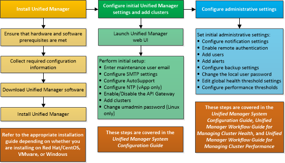

= Active IQ Unified Manager のインストール手順を確認する
:allow-uri-read: 
:icons: font
:imagesdir: ../media/

[role="lead"]
インストールワークフローには、Unified Manager を使用する前に実行する必要があるタスクが記載されています。

以降の各セクションでは、このワークフローの各項目について説明します。

