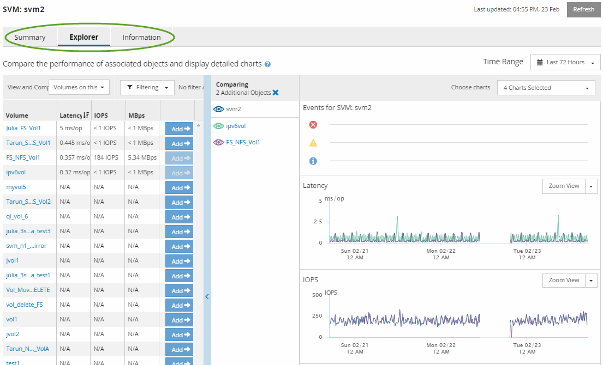

= Active IQ Unified Manager のオブジェクトランディングページのコンポーネントを確認する
:allow-uri-read: 
:icons: font
:imagesdir: ../media/

[role="lead"]
[オブジェクト ランディング]ページには、重大、警告、および情報のすべてのイベントについての詳細が表示されます。すべてのクラスタ オブジェクトのパフォーマンスの詳細が表示され、個々のオブジェクトを選択してさまざまな期間のデータを比較することができます。

[オブジェクト ランディング]ページでは、すべてのオブジェクトの全体的なパフォーマンスを確認したり、オブジェクトのパフォーマンス データを並べて表示して比較したりできます。これはパフォーマンスの評価やイベントのトラブルシューティングを行うときに便利です。

[NOTE]
====
カウンタの概要パネルおよび[カウンタ グラフ]には、5分間のサンプリング間隔に基づくデータが表示されます。ページの左側にあるオブジェクトのインベントリ グリッドには、1時間のサンプリング間隔に基づくデータが表示されます。

====
次の図は、[エクスプローラ]の情報が表示された[オブジェクト ランディング]ページの例を示しています。

[オブジェクト ランディング]ページでは、表示するストレージ オブジェクトに応じて、オブジェクトに関するパフォーマンス データが次のタブに表示されます。

* サマリ
+
各オブジェクトの過去72時間のイベントやパフォーマンスを示すカウンタ グラフが3つか4つ表示されます。グラフには、その期間の高い値と低い値の傾向を示す線も表示されます。

* エクスプローラ
+
現在のオブジェクトに関連するストレージ オブジェクトがグリッド形式で表示され、現在のオブジェクトと関連オブジェクトのパフォーマンスの値を比較することができます。このタブには最大11個のカウンタ グラフと期間セレクタが表示され、さまざまな比較が可能です。

* 情報
+
ストレージ オブジェクトに関するパフォーマンス以外の構成の属性が表示されます。インストールされているONTAPソフトウェアのバージョン、HAパートナーの名前、ポートやLIFの数などが含まれます。

* パフォーマンス上位
+
クラスタの場合：選択したパフォーマンス カウンタに基づいて、パフォーマンスが上位または下位のストレージ オブジェクトが表示されます。

* フェイルオーバー プラン
+
ノードの場合：ノードのHAパートナーで障害が発生した場合のノードのパフォーマンスに対する影響の推定値が表示されます。

* 詳細
+
ボリュームの場合：選択したボリュームのワークロードに対するすべてのI/Oアクティビティと処理について、詳細なパフォーマンス統計が表示されます。このタブは、FlexVol、FlexGroupボリューム、およびFlexGroupのコンスティチュエントに対して表示されます。

