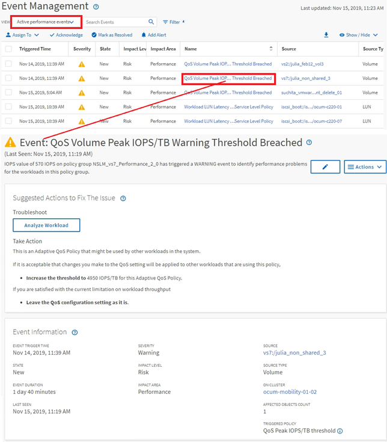

= Active IQ Unified Manager でパフォーマンスイベントを調査する
:allow-uri-read: 
:icons: font
:imagesdir: ../media/

[role="lead"]
Unified Managerのイベント詳細ページには、パフォーマンス イベントに関する詳しい情報が表示されます。トラブルシューティングやシステムのパフォーマンスの微調整を行う際に、このページでパフォーマンス イベントを調査できます。

パフォーマンス イベントのタイプに応じて、次のいずれかのイベント詳細ページが表示されます。

* ユーザ定義およびシステム定義のしきい値ポリシー イベントの[イベントの詳細]ページ
* 動的しきい値ポリシー イベントの[イベントの詳細]ページ

以下は、イベントを調査する際の手順の一例です。

. 左側のナビゲーションペインで、*イベント管理*をクリックします。
. 「表示」メニューから「アクティブなパフォーマンスイベント」をクリックします。
. 調査するイベントの名前をクリックすると、[イベントの詳細]ページが表示されます。
. イベントの[説明]や[推奨される操作]（利用可能な場合）で、問題の解決に役立つイベントに関する詳細を確認します。「ワークロード分析」ボタンをクリックすると、問題のさらなる分析に役立つ詳細なパフォーマンスチャートが表示されます。

