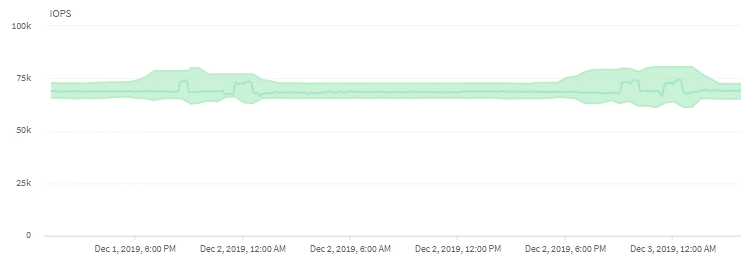

= クラスタ操作がワークロードのレイテンシにどのように影響するかを Active IQ Unified Manager で評価する
:allow-uri-read: 
:icons: font
:imagesdir: ../media/

[role="lead"]
処理（IOPS）には、クラスタで実行されるユーザ定義とシステム定義のすべてのワークロードのアクティビティが含まれます。IOPSの統計は、クラスタでの処理（バックアップの作成や重複排除の実行など）がワークロードのレイテンシ（応答時間）に影響を及ぼしていないかどうかやパフォーマンス イベントの原因となっていないかどうかを確認するのに役立ちます。

パフォーマンス イベントを分析するときは、IOPSの統計を使用して、クラスタにおける問題がパフォーマンス イベントの原因となっていないかどうかを確認できます。パフォーマンス イベントの原因となった可能性がある具体的なワークロード アクティビティを特定することができます。IOPSは1秒あたりの処理数（処理数/秒）として測定されます。

この例は、IOPSのグラフを示しています。実際の処理の統計が青い線で、処理のIOPS予測が緑で表示されています。

[NOTE]
====
クラスターが過負荷状態になった場合、Unified Manager は次のメッセージを表示することがあります `Data collection is taking too long on Cluster _cluster_name_`。これは、Unified Manager が分析するのに十分な統計データが収集されていないことを意味します。統計情報を収集できるように、クラスターが使用するリソースを削減する必要があります。

====