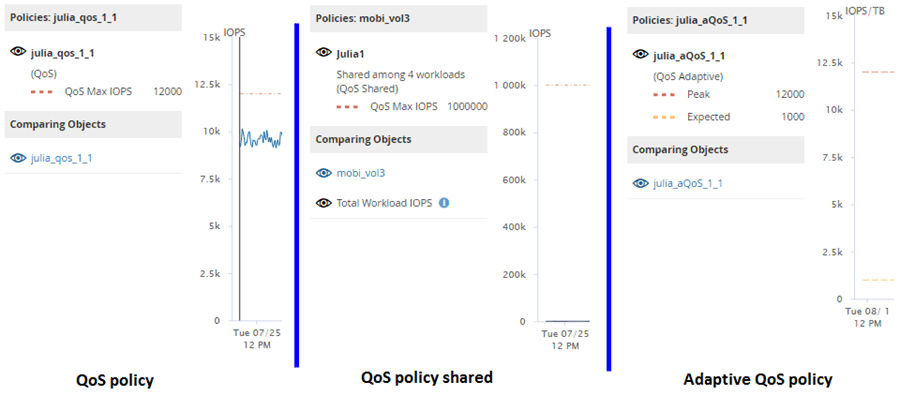

= Active IQ Unified Manager を使用してスループットチャートで QoS ポリシーを表示する
:allow-uri-read: 
:icons: font
:imagesdir: ../media/

[role="lead"]
[パフォーマンス エクスプローラ]と[ワークロード分析]のIOPS、IOPS/TB、およびMBpsの各グラフで、ボリュームやLUNに適用されているONTAP定義のサービス品質（QoS）ポリシーの設定を確認することができます。グラフに表示される情報は、ワークロードに適用されているQoSポリシーのタイプによって異なります。

スループット最大値（または「`peak`」）設定は、ワークロードが消費できる最大スループットを定義し、それによってシステムリソースをめぐる競合ワークロードへの影響を制限します。スループット最小値（または「`expected`」）設定は、競合するワークロードの需要に関係なく、重要なワークロードが最小スループット目標を満たすために、ワークロードに利用可能でなければならない最小スループットを定義します。

IOPSとMB/sの共有QoSポリシーと非共有QoSポリシーでは、「`minimum`」と「`maximum`」という用語を使用して、下限値と上限値を定義します。ONTAP 9.3で導入されたIOPS/TBの適応型QoSポリシーでは、「`expected`」と「`peak`」という用語を使用して、下限値と上限値を定義します。

ONTAPではこの2つのタイプのQoSポリシーを作成できますが、パフォーマンス グラフには、ワークロードへの適用方法に応じて3通りの方法でQoSポリシーが表示されます。

|===
| ポリシーの種類 | 機能 | Unified Managerインターフェースのインジケーター 

 a| 
単一のワークロードに割り当てられた共有のQoSポリシー、単一のワークロードまたは複数のワークロードに割り当てられた非共有のQoSポリシー
 a| 
指定されたスループット設定を各ワークロードが消費可能
 a| 
「`(QoS)`」と表示されます。

 a| 
複数のワークロードに割り当てられた共有のQoSポリシー
 a| 
指定されたスループット設定をすべてのワークロードが共有
 a| 
「`(QoS Shared)`」と表示されます。

 a| 
単一のワークロードまたは複数のワークロードに割り当てられたアダプティブQoSポリシー
 a| 
指定されたスループット設定を各ワークロードが消費可能
 a| 
「`(QoS Adaptive)`」と表示されます。

|===
次の図は、カウンタ グラフでの3通りの表示方法の例を示したものです。

IOPSで定義された通常のQoSポリシーがワークロードのIOPS/TBチャートに表示される場合、ONTAPはIOPS値をIOPS/TB値に変換し、Unified ManagerはIOPS/TBチャートにそのポリシーを「`QoS, defined in IOPS`」というテキストとともに表示します。

IOPS/TBで定義された適応型QoSポリシーがワークロードのIOPSチャートに表示される場合、ONTAPはIOPS/TB 値を IOPS 値に変換し、Unified Manager は、ピーク IOPS 割り当て設定の構成方法に応じて、「`QoS Adaptive - Used, defined in IOPS/TB`」または「`QoS Adaptive - Allocated, defined in IOPS/TB`」というテキストとともに、そのポリシーを IOPS チャートに表示します。割り当て設定が「`allocated-space`」に設定されている場合、ピークIOPSはボリュームのサイズに基づいて計算されます。割り当て設定が「`used-space`」に設定されている場合、ピークIOPSは、ストレージ効率を考慮して、ボリュームに保存されているデータ量に基づいて計算されます。

[NOTE]
====
[IOPS/TB]グラフにパフォーマンス データが表示されるのは、ボリュームで使用されている論理容量が128GB以上のときだけです。選択した期間に使用済み容量が128GBを下回る期間がある場合、その間のデータはグラフに表示されません。

====