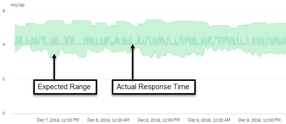

= ワークロードのレイテンシを使用して Active IQ Unified Manager のパフォーマンスの問題を特定する
:allow-uri-read: 
:icons: font
:imagesdir: ../media/

[role="lead"]
ワークロードのレイテンシ（応答時間）は、クラスタ上のボリュームがクライアント アプリケーションからのI/O要求に応答するまでの時間です。Unified Managerは、レイテンシを利用してパフォーマンスイベントを検出し、お客様に通知します。

高レイテンシは、アプリケーションからクラスタ上のボリュームへの要求に通常よりも時間がかかっていることを意味します。高レイテンシの原因はクラスタ自体、具体的にはいくつかのクラスタ コンポーネントでの競合にある可能性があります。また、クラスタ外の問題（ネットワークのボトルネックなど）、アプリケーションをホストしているクライアントの問題、またはアプリケーション自体の問題が原因の場合もあります。

[NOTE]
====
Unified Managerは、クラスタ内のワークロードだけを監視します。アプリケーションやクライアント、アプリケーションとクラスタ間のパスは監視しません。

====
クラスタに対する処理（バックアップの作成や重複排除の実行など）も他のワークロードと共有しているクラスタ コンポーネントへの負荷を増大させるため、高レイテンシの原因になります。実際のレイテンシが想定範囲（レイテンシ予測）の動的パフォーマンスしきい値を超えると、Unified Managerはイベントを分析して、解決が必要なパフォーマンス イベントであるかどうかを判断します。レイテンシは処理あたりのミリ秒（ms/op）単位で測定されます。

[ワークロード分析]ページのレイテンシ合計グラフでは、レイテンシ統計の分析を表示して、個々のプロセス（読み取り / 書き込み要求など）のアクティビティを全体的なレイテンシに照らして比較できます。この比較により、最もアクティビティが高い処理を特定したり、ボリュームのレイテンシに影響を及ぼしている異常なアクティビティがある特定の処理がないかを判断できます。パフォーマンス イベントを分析するにあたっては、レイテンシの統計値を使用してイベントの原因がクラスタ上の問題にあるかどうかを判断できます。また、イベントに関係しているワークロードのアクティビティまたはクラスタ コンポーネントを特定することもできます。

この例は、レイテンシのグラフを示しています。実際の応答時間（レイテンシ）アクティビティは青い線、レイテンシ予測（想定範囲）は緑で表されています。

[NOTE]
====
Unified Managerでデータを収集できなかった期間は、青い線が途切れています。これは、クラスタまたはボリュームと通信できなかったか、Unified Managerがその時間にオフになっていたか、データの収集に5分以上かかった場合に起こります。

====