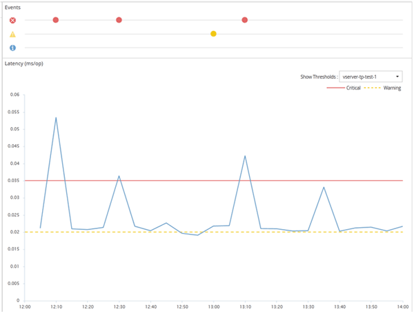

= Active IQ Unified Manager でユーザー定義のパフォーマンスしきい値ポリシーを使用する
:allow-uri-read: 
:icons: font
:imagesdir: ../media/

[role="lead"]
ストレージ オブジェクト（アグリゲートとボリュームなど）に対してパフォーマンスしきい値ポリシーを設定して、クラスタでパフォーマンスの問題が発生していることを通知するイベントをストレージ管理者に送信できるようにします。

ストレージ オブジェクトのパフォーマンスしきい値ポリシーを作成する手順は次のとおりです。

* ストレージ オブジェクトを選択する
* オブジェクトに関連付けられているパフォーマンス カウンタを選択する
* 警告および重大な状況とみなされるパフォーマンス カウンタの上限値を指定する
* カウンタが上限値を超える必要がある期間を指定する

たとえば、ボリュームのIOPSが10分間連続して1秒あたり750件の処理数を超えるたびに重大イベントの通知を受け取るように、ボリュームに対してパフォーマンスしきい値ポリシーを設定できます。同じしきい値ポリシーで、IOPSが10分間継続して1秒あたり500件の処理数を超えたときに警告イベントを送信するように指定することもできます。

[NOTE]
====
現在のリリースでは、カウンタの値が設定値を超えたときにイベントを送信するしきい値を設定できます。カウンタの値が設定値を下回ったときにイベントを送信するしきい値は設定できません。

====
ここにカウンターチャートの例を示します。これは、1：00に警告しきい値（黄色のアイコン）を超え、12：10、12：30、1：10に危険しきい値（赤色のアイコン）を超えたことを示しています：

しきい値の違反は、指定された期間、継続的に発生する必要があります。何らかの理由でしきい値を下回った場合は、その次の違反が新しい期間の開始とみなされます。

一部のクラスタ オブジェクトとパフォーマンス カウンタでは、2つのパフォーマンス カウンタが上限を超えた場合にイベントが生成されるしきい値ポリシーを作成できます。たとえば、次の条件を使用してしきい値ポリシーを作成できます。

|===
| クラスタオブジェクト | パフォーマンスカウンター | 警告しきい値 | クリティカルしきい値 | Duration 

 a| 
Volume
 a| 
[レイテンシ]
 a| 
10ミリ秒
 a| 
20ミリ秒
 a| 
15分

 a| 
Aggregate
 a| 
利用率
 a| 
65%
 a| 
85%
 a| 

|===
2つのクラスタ オブジェクトを使用するしきい値ポリシーでは、両方の条件に違反した場合にのみイベントが生成されます。上の表に定義されたしきい値ポリシーを使用した場合、次のようになります

|===
| ボリュームレイテンシーが平均化されている場合… | そして、ディスクの総使用率は… | 操作 

 a| 
15ミリ秒
 a| 
50%
 a| 
イベントは報告されません。

 a| 
15ミリ秒
 a| 
75%
 a| 
警告イベントが報告されます。

 a| 
25ミリ秒
 a| 
75%
 a| 
警告イベントが報告されます。

 a| 
25ミリ秒
 a| 
90%
 a| 
重大イベントが報告されます。

|===