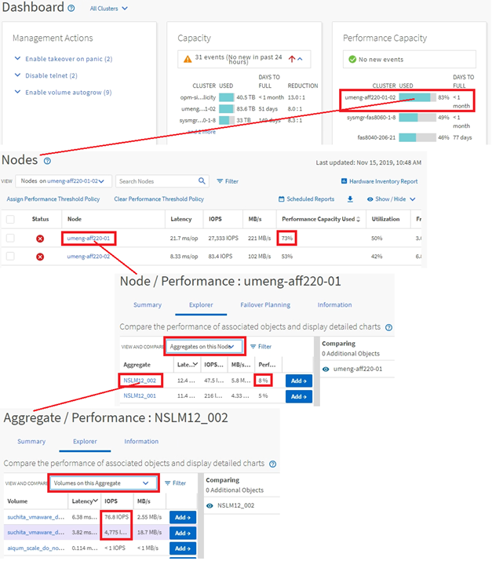

= Active IQ Unified Manager でクラスターオブジェクトのナビゲーションを監視する
:allow-uri-read: 
:icons: font
:imagesdir: ../media/

[role="lead"]
Unified Managerで管理しているクラスタ内のすべてのオブジェクトのパフォーマンスを監視できます。ストレージ オブジェクトの監視では、クラスタとオブジェクトのパフォーマンスの概要を確認し、パフォーマンス イベントを監視します。パフォーマンスとイベントの総合的な情報を表示することも、オブジェクトのパフォーマンスとパフォーマンス イベントの詳しいデータを表示して調査することもできます。

次に、クラスタ オブジェクトを監視する際の操作例を紹介します。

. [ダッシュボード]ページで、[パフォーマンス容量]パネルの詳細を確認して使用済みパフォーマンス容量が最も多いクラスタを特定し、棒グラフをクリックしてそのクラスタのノードのリストに移動します。
. 使用済みパフォーマンス容量の値が最も高いノードを特定し、そのノードをクリックします。
. ノード/パフォーマンスエクスプローラーページから、「表示と比較」メニューの「このノードのアグリゲート」をクリックします。
. 使用済みパフォーマンス容量が最も多いアグリゲートを特定し、そのアグリゲートをクリックします。
. Aggregate / Performance Explorerページから、「表示と比較」メニューの「このAggregateのボリューム」をクリックします。
. IOPSが最も高いボリュームを特定します。

特定したボリュームを調べて、QoSポリシーまたはパフォーマンス サービス レベル ポリシーを適用するかどうかを判断するか、またはポリシーの設定を変更し、これらのボリュームが使用するIOPSの割合が少なくなるようにします。

