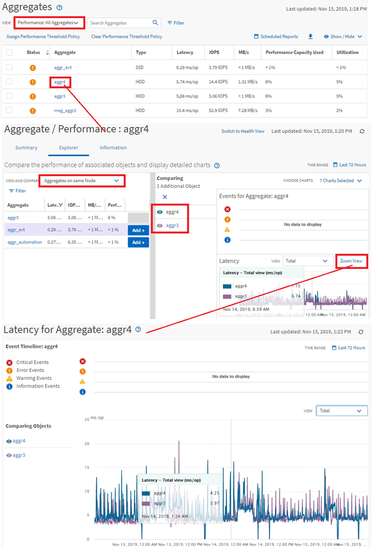

= Active IQ Unified Manager でのクラスターパフォーマンスナビゲーションの監視
:allow-uri-read: 
:icons: font
:imagesdir: ../media/

[role="lead"]
Unified Managerで管理しているすべてのクラスタのパフォーマンスを監視できます。クラスタの監視では、クラスタとオブジェクトのパフォーマンスの概要を確認し、パフォーマンス イベントを監視します。パフォーマンスとイベントの総合的な情報を表示することも、クラスタとオブジェクトのパフォーマンス、パフォーマンス イベントの詳しいデータを表示して調査することもできます。

次に、クラスタ パフォーマンスを監視する際の操作例を紹介します。

. 左側のナビゲーションペインで、*ストレージ*>*アグリゲート*をクリックします。
. これらのアグリゲートのパフォーマンスに関する情報を表示するには、「Performance: All Aggregates」ビューを選択してください。
. 調査するアグリゲートを特定し、そのアグリゲート名をクリックして[アグリゲート / パフォーマンス エクスプローラ]ページに移動します。
. 必要に応じて、[表示して比較]メニューでこのアグリゲートと比較する他のオブジェクトを選択し、そのうちの1つを比較ペインに追加します。
+
両方のオブジェクトの統計データが、比較できるようにカウンタ グラフに表示されます。

. エクスプローラーページの右側にある比較ペインで、カウンターチャートのいずれかにある「ズームビュー」をクリックすると、その集計値のパフォーマンス履歴の詳細が表示されます。

