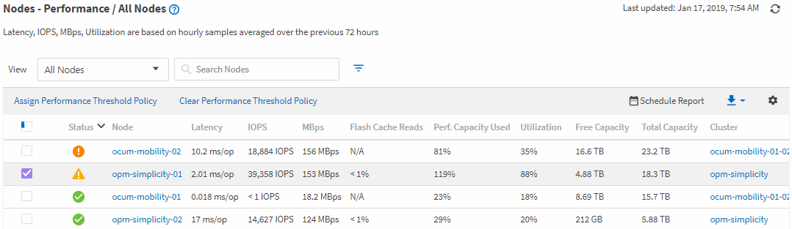

= Active IQ Unified Manager のパフォーマンスインベントリページを使用してオブジェクトのパフォーマンスを監視する
:allow-uri-read: 
:icons: font
:imagesdir: ../media/

[role="lead"]
[オブジェクト インベントリ パフォーマンス]ページには、そのオブジェクト タイプ カテゴリ内のすべてのオブジェクトのパフォーマンス情報、パフォーマンス イベント、および健全性が表示されます。これにより、クラスタ内の各オブジェクト（すべてのノードまたはすべてのボリュームなど）のパフォーマンス ステータスの概要をひと目で確認できます。

[オブジェクト インベントリ パフォーマンス]ページには、オブジェクト ステータスの概要が表示されるため、すべてのオブジェクトの全体的なパフォーマンスを評価して、オブジェクトのパフォーマンス データを比較できます。[オブジェクト インベントリ]ページの内容は、検索、ソート、フィルタリングによって絞り込むことができます。パフォーマンスの問題があるオブジェクトをすばやく特定してトラブルシューティング プロセスを開始できるため、オブジェクトのパフォーマンスを監視および管理する場合に役立ちます。

パフォーマンス インベントリ ページのオブジェクトは、デフォルトでは、オブジェクトのパフォーマンスの重大度に基づいてソートされます。新しい重大なパフォーマンス イベントが報告されたオブジェクトが最初に表示され、そのあとに警告イベントが報告されたオブジェクトが表示されます。これにより、対処が必要な問題を簡単に特定できます。パフォーマンス データはいずれも72時間の平均値です。

オブジェクト名列のオブジェクト名をクリックすることで、オブジェクトインベントリのパフォーマンスページからオブジェクトの詳細ページに簡単に移動できます。例えば、Performance/All Nodes インベントリページで、「Nodes」列のノードオブジェクトをクリックします。オブジェクトの詳細ページには、選択したオブジェクトに関する詳細な情報が表示され、アクティブなイベントを並べて比較することもできます。
