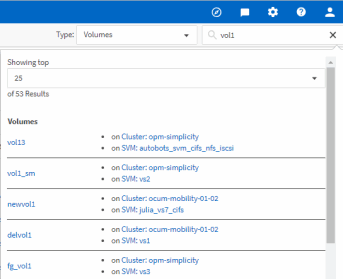

= Active IQ Unified Manager でストレージオブジェクトを検索する
:allow-uri-read: 
:icons: font
:imagesdir: ../media/

[role="lead"]
特定のオブジェクトにすばやくアクセスするには、メニューバー上部の「すべてのストレージオブジェクトを検索」フィールドを使用できます。この、すべてのオブジェクトを対象としたグローバル検索方法により、種類別に特定のオブジェクトをすばやく見つけることができます。検索結果はストレージオブジェクトの種類ごとに並べ替えられ、ドロップダウンメニューを使用して絞り込むことができます。有効な検索語句には、少なくとも3文字が含まれている必要があります。

グローバル検索では結果の総数が表示されますが、アクセスできるのは上位25件の検索結果のみです。そのため、グローバル検索機能は、探したいアイテムが分かっている場合に、特定のアイテムを素早く見つけるためのショートカットツールと考えることができます。完全な検索結果を得るには、オブジェクトインベントリページの検索機能と、それに関連するフィルタリング機能をご利用ください。

ドロップダウンボックスをクリックして「すべて」を選択すると、すべてのオブジェクトとイベントを同時に検索できます。または、ドロップダウンボックスをクリックしてオブジェクトの種類を指定することもできます。「すべてのストレージオブジェクトを検索」フィールドにオブジェクト名またはイベント名を3文字以上入力し、*Enter* キーを押すと、次のような検索結果が表示されます。

* クラスタ：クラスタ名
* ノード：ノード名
* アグリゲート：アグリゲート名
* SVM：SVM名
* ボリューム：ボリューム名
* LUN：LUNパス

[NOTE]
====
LIFとポートは、グローバル検索バーでは検索できません。

====
この例では、ドロップダウンボックスで「ボリューム」オブジェクトタイプが選択されています。「すべてのストレージオブジェクトを検索」フィールドに「`vol`」と入力すると、名前にこれらの文字が含まれるすべてのボリュームのリストが表示されます。オブジェクト検索の場合、検索結果をクリックすると、そのオブジェクトのパフォーマンスエクスプローラーページに移動できます。イベント検索の場合、検索結果の項目をクリックすると、イベント詳細ページに移動します。
