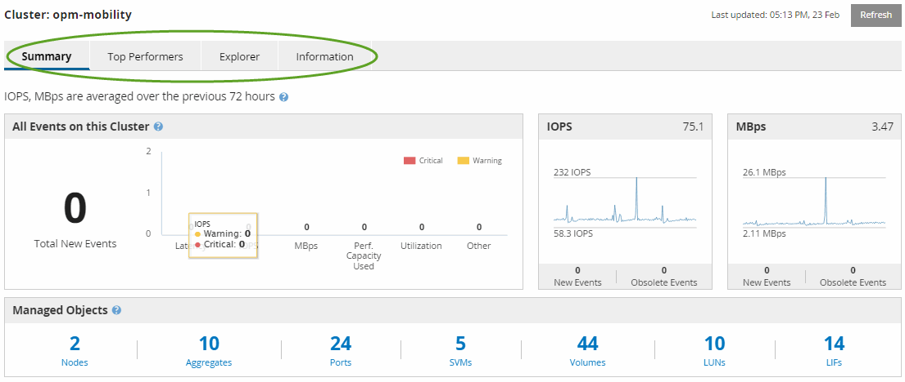

= Active IQ Unified Manager のパフォーマンスクラスターランディングページについて
:allow-uri-read: 
:icons: font
:imagesdir: ../media/

[role="lead"]
[パフォーマンス クラスタ ランディング]ページには、選択したクラスタのパフォーマンスの概要とクラスタ内の上位10個のオブジェクトのパフォーマンス ステータスが表示されます。パフォーマンスの問題は、ページ上部の[このクラスタのすべてのイベント]パネルに表示されます。

[パフォーマンス クラスタ ランディング]ページには、Unified Managerのインスタンスで管理されている各クラスタの概要が表示されます。このページでは、イベントとパフォーマンスに関する情報が提供され、クラスタの監視とトラブルシューティングを行うことができます。次の図は、opm-mobilityというクラスタの[パフォーマンス クラスタ ランディング]ページの例を示しています。

[クラスタ サマリ]ページのイベント件数は、[パフォーマンス イベント インベントリ]ページのイベント件数と一致しない場合があります。これは、組み合わせしきい値ポリシーに違反した場合、[クラスタ サマリ]ページでは[レイテンシ]バーと[利用率]バーにそれぞれ1つのイベントを表示できるのに対して、[パフォーマンス イベント インベントリ]ページでは1つのイベントしか表示されないためです。

[NOTE]
====
クラスターがUnified Managerによる管理対象から削除された場合、ページ上部のクラスター名の右側に*削除済み*というステータスが表示されます。

====