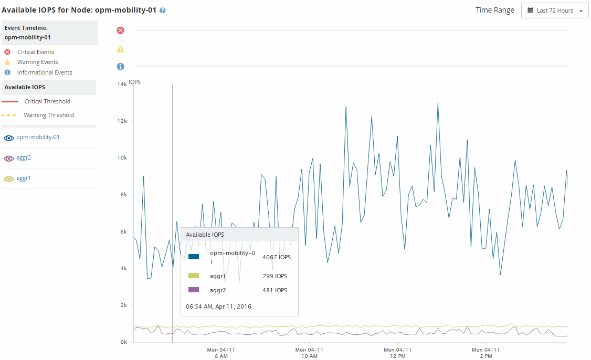

= ノードとアグリゲートの利用可能な IOPS 値を Active IQ Unified Manager で表示する
:allow-uri-read: 
:icons: font
:imagesdir: ../media/

[role="lead"]
クラスタ内のすべてのノードまたはアグリゲートの使用可能なIOPSの値、または、1つのノードあるいはアグリゲートの詳細を表示できます。

利用可能なIOPS値は、パフォーマンスインベントリページおよびパフォーマンスエクスプローラページのノードとアグリゲートのグラフに表示されます。たとえば、ノード/パフォーマンスエクスプローラページでノードを表示する際、リストから「`利用可能なIOPS`」カウンタチャートを選択すると、そのノードと、そのノード上の複数のアグリゲートの利用可能なIOPS値を比較できます。

利用可能なIOPSカウンターを監視することで、以下のことが特定できます：

* 使用可能なIOPSの値が最も大きいノードまたはアグリゲート。今後ワークロードを導入可能な場所を判断します。
* 使用可能なIOPSの値が最も小さいノードまたはアグリゲート。今後発生する可能性のあるパフォーマンスの問題について監視が必要なリソースを特定します。
* 使用可能なIOPSの値が小さいアグリゲート上の最も負荷の高いボリュームとLUN。

