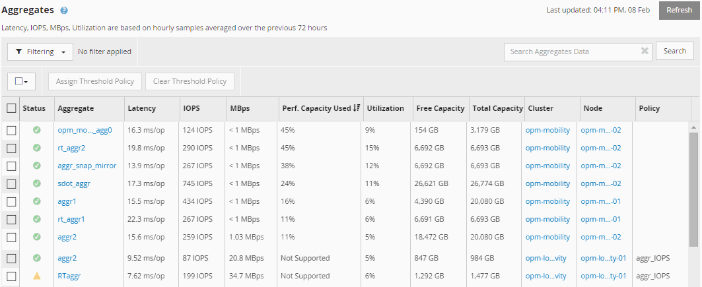

= Active IQ Unified Manager でノードとアグリゲートのパフォーマンス容量使用値を表示する
:allow-uri-read: 
:icons: font
:imagesdir: ../media/

[role="lead"]
クラスタ内のすべてのノードまたはアグリゲートの使用済みパフォーマンス容量の値、または、1つのノードあるいはアグリゲートの詳細を表示できます。

パフォーマンス容量の使用値は、ダッシュボード、パフォーマンスインベントリページ、トップパフォーマーページ、しきい値ポリシーの作成ページ、パフォーマンスエクスプローラーページ、および詳細チャートに表示されます。たとえば、パフォーマンス：すべてのアグリゲートページにはパフォーマンス容量の使用値列があり、すべてのアグリゲートのパフォーマンス容量の使用値を確認できます。

パフォーマンス容量使用カウンターを監視することで、以下の点を特定できます：

* クラスタ上に使用済みパフォーマンス容量の値が大きいノードまたはアグリゲートがないか
* クラスタ上にアクティブな使用済みパフォーマンス容量のイベントが発生しているノードまたはアグリゲートがないか
* 使用済みパフォーマンス容量の値がクラスタ内で最も大きい、または小さいノードとアグリゲート
* 使用済みパフォーマンス容量の値が大きいノードまたはアグリゲートにおける[レイテンシ]カウンタと[利用率]カウンタの値
* HAペアのどちらかのノードに障害が発生した場合のノードの使用済みパフォーマンス容量への影響
* 使用済みパフォーマンス容量の値が大きいアグリゲート上の最も負荷の高いボリュームとLUN

