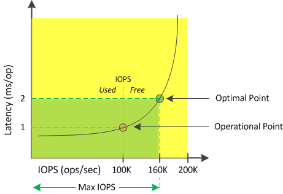

= Active IQ Unified Manager で利用可能な IOPS を理解する
:allow-uri-read: 
:icons: font
:imagesdir: ../media/

[role="lead"]
使用可能なIOPSカウンタは、リソースの上限に達するまでにノードまたはアグリゲートに追加できる残りのIOPSの数を示します。

ノードで提供可能な合計IOPSは、CPUの数、CPUの速度、RAMの容量など、ノードの物理仕様に基づきます。アグリゲートで提供可能な合計IOPSは、ディスクがSATA、SAS、またはSSDのいずれであるかなど、ディスクの物理特性に基づきます。

アグリゲート内のすべてのボリュームの合計IOPSは、アグリゲートの合計IOPSと一致しない場合があります。これについては、以下のナレッジベース記事で説明されています：KB link:https://kb.netapp.com/Advice_and_Troubleshooting/Data_Infrastructure_Management/Active_IQ_Unified_Manager/Why_does_the_sum_of_all_volume_IOPs_in_an_aggregate_not_match_the_aggregate_IOPs%3F["アグリゲート内のすべてのボリュームのIOPsの合計が、アグリゲートのIOPsと一致しないのはなぜですか？"]

空きパフォーマンス容量カウンタは使用可能な残りのリソースの割合を示すのに対し、使用可能なIOPSカウンタは最大パフォーマンス容量に達するまでにリソースに追加できるIOPS（ワークロード）の正確な数を示します。

たとえば、FAS2520とFAS8060のストレージ システムを使用している場合、空きパフォーマンス容量の値が30%であれば、空きパフォーマンス容量がいくらか残っていることがわかります。ただし、この値からは、それらのノードに追加で導入できるワークロードの数はわかりません。使用可能なIOPSカウンタの場合は、使用可能なIOPSがFAS8060には500あり、FAS2520には100だけのように、正確な数が示されます。

ノードのレイテンシとIOPSの関係を示す曲線の例を次の図に示します。

リソースで提供可能な最大IOPSは、使用済みパフォーマンス容量カウンタが100%（最適ポイント）の時点のIOPSの数です。運用ポイントから、このノードの現在のIOPSは100Kで、レイテンシは1.0ミリ秒/処理です。ノードからキャプチャされたUnified Managerの統計によると、このノードの最大IOPSは160Kであり、あと60KのIOPSを利用できます。したがって、このノードにさらにワークロードを追加することで、システムをより効率的に使用することができます。

[NOTE]
====
ユーザ アクティビティが少ないリソースについては、一般的なワークロードを想定し、CPUコアあたりのIOPSを約4,500として使用可能なIOPSの値が計算されます。これは、配分されるワークロードの特性を正確に見積もるためのデータがUnified Managerで得られないためです。

====