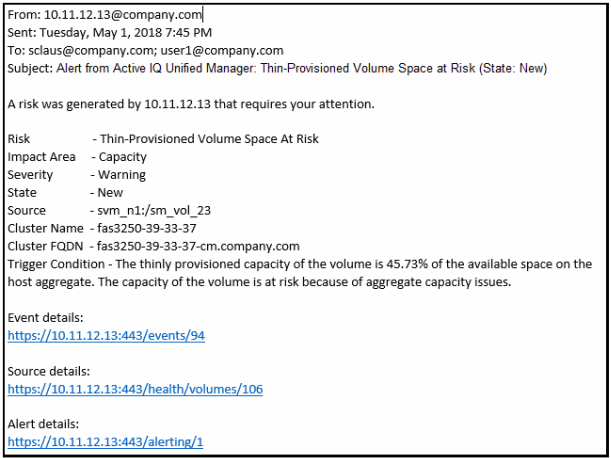

= Active IQ Unified Manager のアラートメールの情報を確認する
:allow-uri-read: 
:icons: font
:imagesdir: ../media/

[role="lead"]
Unified ManagerのアラートEメールには、イベントのタイプ、イベントの重大度、イベントの原因となった違反したポリシーまたはしきい値の名前、およびイベントの説明が記載されています。また、UIでイベントの詳細ページを確認できるように、各イベントのハイパーリンクもEメール メッセージ内に記載されています。

アラートEメールは、アラートを受信するように登録しているすべてのユーザに送信されます。

パフォーマンス カウンタや容量の値が収集期間内に大きく変わった場合、同じしきい値ポリシーに対して重大イベントと警告イベントの両方が同時にトリガーされることがあります。この場合、警告イベントのEメールと重大イベントのEメールを1通ずつ受信する可能性があります。これは、Unified Managerでは、警告と重大のしきい値違反に対するアラートを受信するように個別に登録できるためです。

アラートEメールの例を次に示します。

