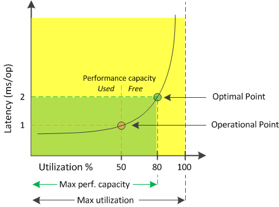

= Active IQ Unified Manager の「使用済みパフォーマンス容量」カウンターについて
:allow-uri-read: 
:icons: font
:imagesdir: ../media/

[role="lead"]
使用済みパフォーマンス容量カウンタは、それ以上ワークロードが増えるとパフォーマンスが低下する可能性があるポイントにノードまたはアグリゲートのパフォーマンスが達していないかどうかを特定するのに役立ちます。また、特定の期間のノードまたはアグリゲートの使用率が高すぎないかどうかを調べることもできます。使用済みパフォーマンス容量は、利用率と似ていますが、特定のワークロードに使用できる物理リソースのパフォーマンス容量に関するより詳しい情報を提供します。

ノードまたはアグリゲートの利用率とレイテンシ（応答時間）が最適で、効率的に使用されているポイントが、使用済みパフォーマンス容量の最適ポイントとなります。アグリゲートのレイテンシと利用率の関係を示す曲線の例を次の図に示します。

この例では、_operational point_ は、アグリゲートが現在 50% の利用率で動作しており、レイテンシが 1.0 ms/op であることを示しています。アグリゲートから取得した統計情報に基づいて、Unified Manager はこのアグリゲートに対して追加のパフォーマンス容量が利用可能であると判断します。この例では、アグリゲートの利用率が 80% で、レイテンシが 2.0 ms/op の時点が _optimal point_ として特定されます。したがって、このアグリゲートにボリュームや LUN を追加することで、システムをより効率的に利用できます。

パフォーマンス容量の使用カウンターは、パフォーマンス容量がレイテンシへの影響を加算するため、「`utilization`」カウンターよりも大きな値になると予想されます。例えば、ノードまたはアグリゲートの使用率が70%の場合、パフォーマンス容量の値は、レイテンシの値に応じて80%から100%の範囲になる可能性があります。

ただし、[ダッシュボード]ページでは、利用率カウンタの値の方が大きくなることがあります。これは、このダッシュボードには、Unified Managerのユーザ インターフェイスの他のページのような一定期間の平均値ではなく、各収集期間の最新のカウンタの値が更新されて表示されるためです。使用済みパフォーマンス容量カウンタは一定期間のパフォーマンスの平均を確認するのに適した指標であり、利用率カウンタは特定の時点でのリソースの使用状況を確認するのに適した指標です。
