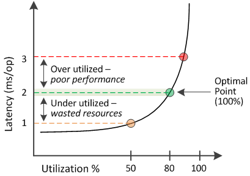

= Active IQ Unified Manager でパフォーマンス容量使用値を使用する
:allow-uri-read: 
:icons: font
:imagesdir: ../media/

[role="lead"]
使用済みパフォーマンス容量の値は、利用率が高い状態や低い状態のノードやアグリゲートを特定するのに役立ちます。この情報に基づいて、ストレージ リソースをより効率的に活用できるようにワークロードを再分配することができます。

次の図は、リソースのレイテンシと利用率の関係を示す曲線を示したものです。現在の運用ポイントを色付きの3つの点で示してあります。

* 使用済みパフォーマンス容量が100%の状態が最適ポイントです。
+
このポイントであれば、リソースが効率的に使用されています。

* 使用済みパフォーマンス容量が100%を超えている場合は、ノードまたはアグリゲートの利用率が高く、ワークロードのパフォーマンスが最適な状態ではないことを示します。
+
新しいワークロードをリソースに追加することは推奨されず、既存のワークロードの再分配が必要になる可能性があります。

* 使用済みパフォーマンス容量が100%未満の場合は、ノードまたはアグリゲートの利用率が低く、リソースが効率的に活用されていないことを示します。
+
リソースにワークロードをさらに追加することができます。

[NOTE]
====
利用率とは異なり、使用済みパフォーマンス容量は100%を超えることがあります。この値に上限はありませんが、一般に、リソースの利用率が高いときで110～140%ほどになります。この値が大きいほど、リソースの問題が深刻であることを示します。

====