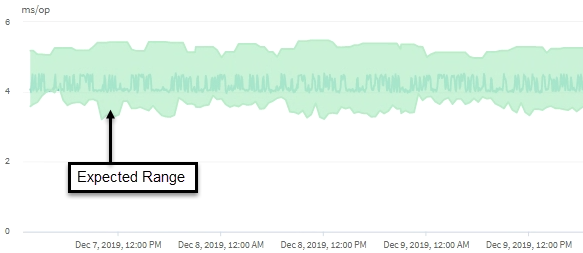

= Active IQ Unified Manager でパフォーマンス分析にレイテンシー予測を使用する
:allow-uri-read: 
:icons: font
:imagesdir: ../media/

[role="lead"]
Unified Managerは、レイテンシ予測を使用して監視対象のワークロードの一般的なI/Oレイテンシ（応答時間）を表します。ワークロードの実際のレイテンシがレイテンシ予測の上限を上回るとアラートが生成されて動的なパフォーマンス イベントがトリガーされるため、パフォーマンスの問題を分析して解決することができます。

レイテンシ予測は、ワークロードのパフォーマンス ベースラインです。Unified Managerは、時間の経過とともに過去のパフォーマンス測定値から学習し、ワークロードの予想されるパフォーマンスとアクティビティレベルを予測します。想定範囲の上限が、動的パフォーマンスのしきい値を設定します。Unified Managerは、ベースラインを使用して、実際のレイテンシがしきい値を超えているか下回っているか、または想定される範囲を超えているかを判断します。実際値と期待値を比較することで、ワークロードのパフォーマンスプロファイルが作成されます。

あるワークロードの実際のレイテンシがクラスタ コンポーネントの競合が原因で動的なパフォーマンスしきい値を超えると、レイテンシが上昇し、ワークロードのパフォーマンスは想定を下回ります。同じクラスタ コンポーネントを共有する他のワークロードのパフォーマンスも想定より遅くなる可能性があります。

Unified Managerは、しきい値超過イベントを分析し、そのアクティビティがパフォーマンスイベントであるかどうかを判断します。高負荷状態が数時間など長期間継続する場合、Unified Manager はその状態を正常と判断し、レイテンシ予測を動的に調整して新しい動的パフォーマンスしきい値を生成します。

ワークロードによっては、レイテンシ予測が時間が経過しても大きく変化することがない、アクティビティが一貫して低いワークロードもあります。このような低アクティビティのボリュームについては、イベントの数を最小限に抑えるために、パフォーマンス イベントの分析中、Unified Managerは処理数およびレイテンシが想定よりもはるかに高いイベントのみをトリガーします。

この例のボリュームのレイテンシ予測（緑で表示）は、3.5～5.5ms/opです。ネットワーク トラフィックの一時的な急増やクラスタ コンポーネントの競合が原因で実際のレイテンシ（青）が突然10ms/opまで増加した場合、レイテンシ予測を上回り、動的なパフォーマンスしきい値を超過します。

ネットワーク トラフィックが減少するか、クラスタ コンポーネントの競合が解消されると、レイテンシはレイテンシ予測の範囲内に戻ります。レイテンシが長期間にわたって10ms/op以上のままの場合、イベントを解決するための対処が必要となることがあります。
