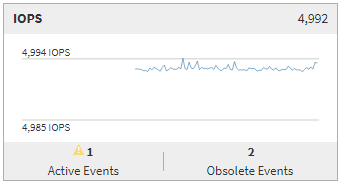

= Active IQ Unified Manager のパフォーマンス概要ページを確認する
:allow-uri-read: 
:icons: font
:imagesdir: ../media/

[role="lead"]
[サマリ]ページには、過去72時間を対象に、オブジェクト別のイベントとパフォーマンスの詳細を含むカウンタ グラフが表示されます。このデータは自動的に更新されませんが、前回のページ読み込み時点の最新情報です。概要ページのグラフは、「さらに詳しく調べる必要があるか？」という疑問に答えます。

[[charts-and-counter-statistics]]
== グラフとカウンタの統計

サマリ グラフには、過去72時間の概要が表示され、さらに調査が必要な潜在的な問題の特定に役立ちます。

[サマリ]ページのカウンタ値はグラフに表示されます。

グラフ上のラインにカーソルを合わせると、特定の時点のカウンタ値を表示できます。サマリ グラフには、以下のカウンタについて、過去72時間のアクティブな重大イベントと警告イベントの合計数も表示されます。

* *レイテンシ*
+
すべてのI/O要求の平均応答時間。処理あたりのミリ秒で表されます。

+
すべてのオブジェクト タイプについて表示されます。

* *IOPS*
+
平均処理速度。1秒あたりの入出力処理数で表されます。

+
すべてのオブジェクト タイプについて表示されます。

* *MB/s*
+
平均スループット。1秒あたりのメガバイト数で表されます。

+
すべてのオブジェクト タイプについて表示されます。

* *使用済みパフォーマンス容量*
+
ノードまたはアグリゲートによるパフォーマンス容量の平均消費率。

+
ノードとアグリゲートのみに表示されます。

* *利用*
+
ノードとアグリゲートのオブジェクト利用率、またはポートの帯域幅利用率。

+
ノード、アグリゲート、およびポートについてのみ表示されます。

アクティブなイベントのイベント件数にカーソルを合わせると、各イベントのタイプと数が表示されます。重大イベントは赤（）、警告イベントは黄色（）で表示されます。

グラフ右上のグレーのバーに表示される数字は、過去72時間の平均値です。トレンド グラフの上下に表示される数字は、過去72時間の最大値と最小値です。グラフ下のグレーのバーには、過去72時間のアクティブなイベント（新規および確認済みのイベント）と廃止イベントの件数が表示されます。

* *レイテンシカウンターチャート*
+
[レイテンシ]カウンタのグラフでは、過去72時間のオブジェクトのレイテンシの概要を確認できます。レイテンシは、すべてのI/O要求の平均応答時間（処理あたりのミリ秒）を表し、クラスタ ストレージ コンポーネントのデータ パケットまたはブロックの処理時間、待機時間、またはその両方が考慮されます。

+
*上部（カウンター値）：* ヘッダーの数値は、直前の72時間の平均値を示します。

+
*中央（パフォーマンスグラフ）：*グラフの下部の数値は、過去72時間における最低レイテンシを示し、グラフの上部の数値は、過去72時間における最高レイテンシを示します。特定の時間のレイテンシ値を表示するには、カーソルをグラフのトレンドライン上に移動してください。

+
*下部（イベント）：*マウスカーソルを合わせると、ポップアップにイベントの詳細が表示されます。グラフの下にある*アクティブなイベント*リンクをクリックすると、イベントインベントリページに移動し、イベントの完全な詳細を確認できます。

* *IOPSカウンターチャート*
+
[IOPS]カウンタのグラフでは、過去72時間のオブジェクトのIOPSの概要を確認できます。IOPSは、ストレージ システムの処理速度（1秒あたりのI/O処理数）を示します。

+
*上部（カウンター値）：* ヘッダーの数値は、直前の72時間の平均値を示します。

+
*中央（パフォーマンスグラフ）：*グラフの下部の数値は、過去72時間における最低IOPSを示し、グラフの上部の数値は、過去72時間における最高IOPSを示します。特定の時間のIOPS値を表示するには、グラフのトレンドラインにカーソルを合わせてください。

+
*下部（イベント）：*マウスカーソルを合わせると、ポップアップにイベントの詳細が表示されます。グラフの下にある*アクティブなイベント*リンクをクリックすると、イベントインベントリページに移動し、イベントの完全な詳細を確認できます。

* *MB/sカウンターチャート*
+
[MBps]カウンタのグラフには、オブジェクトのMBpsパフォーマンスが表示されます。これは、オブジェクトとの間で転送されたデータの量（1秒あたりのメガバイト数）を示します。[MBps]カウンタのグラフでは、過去72時間のオブジェクトのMBpsの概要を確認できます。

+
*上部（カウンター値）：* ヘッダーの数値は、直前の72時間の平均MB/秒数を示します。

+
*中央（パフォーマンスグラフ）：*グラフの下部の値は、過去72時間における最低MB/s値を示し、グラフの上部の値は、過去72時間における最高MB/s値を示します。特定の時間のMB/s値を表示するには、カーソルをグラフのトレンドライン上に移動してください。

+
*下部（イベント）：*マウスカーソルを合わせると、ポップアップにイベントの詳細が表示されます。グラフの下にある*アクティブなイベント*リンクをクリックすると、イベントインベントリページに移動し、イベントの完全な詳細を確認できます。

* *性能容量使用率カウンターチャート*
+
[使用済みパフォーマンス容量]カウンタのグラフには、オブジェクトが消費しているパフォーマンス容量の割合が表示されます。

+
*上部（カウンター値）：* ヘッダーの数値は、直前の72時間の平均使用パフォーマンス容量を示します。

+
*中央（パフォーマンスグラフ）：*グラフの下部の値は、過去72時間における使用パフォーマンス容量の最低パーセンテージを示し、グラフの上部の値は、過去72時間における使用パフォーマンス容量の最高パーセンテージを示します。グラフのトレンドラインにカーソルを合わせると、特定の時間における使用済みパフォーマンス容量の値が表示されます。

+
*下部（イベント）：*マウスカーソルを合わせると、ポップアップにイベントの詳細が表示されます。グラフの下にある*アクティブなイベント*リンクをクリックすると、イベントインベントリページに移動し、イベントの完全な詳細を確認できます。

* *利用状況カウンターチャート*
+
[利用率]カウンタのグラフには、オブジェクトの利用率が表示されます。[利用率]カウンタのグラフでは、過去72時間のオブジェクトまたは帯域幅の利用率の概要を確認できます。

+
*上部（カウンター値）：* ヘッダーの数値は、直前の72時間の平均利用率を示します。

+
*中央（パフォーマンスグラフ）：*グラフの下部の値は、過去72時間における最低利用率を示し、グラフの上部の値は、最高利用率を示します。特定の期間における利用率の値を確認するには、グラフのトレンドラインにカーソルを合わせてください。

+
*下部（イベント）：*マウスカーソルを合わせると、ポップアップにイベントの詳細が表示されます。グラフの下にある*アクティブなイベント*リンクをクリックすると、イベントインベントリページに移動し、イベントの完全な詳細を確認できます。

[[events]]
== イベント

該当する場合、イベント履歴テーブルに、そのオブジェクトで発生した最近のイベントが表示されます。イベント名をクリックすると、[イベントの詳細]ページにイベントの詳細が表示されます。
