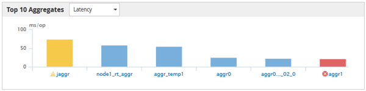

= Active IQ Unified Manager でトップパフォーマーのページを表示する
:allow-uri-read: 
:icons: font
:imagesdir: ../media/

[role="lead"]
[パフォーマンス上位]ページには、選択したパフォーマンス カウンタに基づいて、パフォーマンスが上位または下位のストレージ オブジェクトが表示されます。例えば、「ストレージVM」カテゴリでは、IOPSが最も高いSVM、レイテンシが最も高いSVM、またはMB/sが最も低いSVMを表示できます。また、パフォーマンスが上位のオブジェクトでアクティブなパフォーマンス イベント（新規または確認済みのイベント）が発生しているかどうかも表示されます。

[パフォーマンス上位]ページには、各オブジェクトが最大10個表示されます。[ボリューム]オブジェクトにはFlexVolボリュームとFlexGroupボリュームの両方が含まれることに注意してください。

* *時間帯*
+
上位のオブジェクトを表示する期間を選択できます。選択した期間はすべてのストレージ オブジェクトに適用されます。使用可能な期間は次のとおりです。

+
** 過去 1 時間
** 過去 24 時間
** 過去 72 時間（デフォルト）
** 過去 7 日間

* *メトリック*
+
別のカウンターを選択するには、「メトリック」メニューをクリックしてください。カウンターのオプションは、オブジェクトの種類ごとに異なります。例えば、*Volumes* オブジェクトで使用可能なカウンターには、*Latency*、*IOPS*、および *MB/s* があります。カウンターを変更すると、選択したカウンターに基づいて上位のパフォーマーのパネルデータが再読み込みされます。

+
使用可能なカウンタは次のとおりです。

+
** [レイテンシ]
** [IOPS]
** MB/秒
** パフォーマンス容量使用量（ノードおよびアグリゲートの場合）
** 利用率（ノードとアグリゲートの場合）

* *ソート*
+
*並べ替え*メニューをクリックして、選択したオブジェクトとカウンターの昇順または降順を選択します。選択肢は*高い順から低い順*と*低い順から高い順*です。これらのオプションを使用すると、パフォーマンスが最も高いオブジェクトまたは最も低いオブジェクトを表示できます。

* *カウンターバー*
+
グラフ内のカウンターバーは、各オブジェクトのパフォーマンス統計を示しており、それぞれのアイテムごとに棒グラフで表されています。棒グラフは色分けされています。カウンターがパフォーマンスのしきい値を超えていない場合、カウンターバーは青色で表示されます。しきい値違反がアクティブである場合（新規または認識されたイベント）、バーはイベントの色で表示されます。警告イベントは黄色で表示され（）、重大なイベントは赤色で表示されます（）。しきい値超過は、警告イベントと重大イベントを示す重大度イベントインジケーターアイコンによってさらに示されます。

+

+
各グラフのX軸には、選択したオブジェクト タイプの上位のオブジェクトが表示されます。Y軸には、選択したカウンタに対応する単位が表示されます。棒グラフの各要素の下にあるオブジェクト名のリンクをクリックすると、選択したオブジェクトの[パフォーマンス ランディング]ページに移動します。

* *重大度イベント指標*
+
*重大度イベント* インジケーターアイコンは、上位成績者のグラフにおけるアクティブなクリティカル（image:../media/sev_critical_um60.png["イベントの重大度を示すアイコン – 重大"]）または警告（image:../media/sev_warning_um60.png["イベントの重大度を示すアイコン – 警告"]）イベントのオブジェクト名の左側に表示されます。*重大度イベント* インジケーターアイコンをクリックすると、以下が表示されます：

+
** *イベント1件*
+
そのイベントの[イベントの詳細]ページに移動します。

** *2つ以上のイベント*
+
[イベント インベントリ]ページに移動します。選択したオブジェクトのすべてのイベントが表示されます。

* *エクスポートボタン*
+
カウンターバーに表示されるデータを含む `.csv`ファイルを作成します。表示している単一のクラスターに対してファイルを作成するか、データセンター内のすべてのクラスターに対してファイルを作成するかを選択できます。

