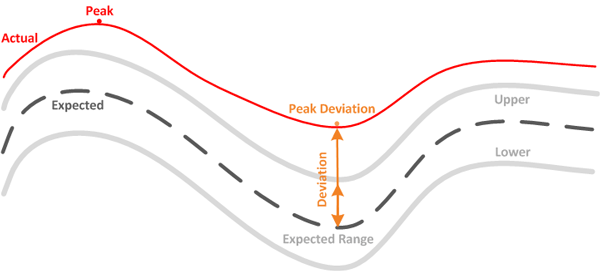

= Active IQ Unified Manager におけるワークロードのパフォーマンス測定値について
:allow-uri-read: 
:icons: font
:imagesdir: ../media/

[role="lead"]
Unified Managerは、過去の統計値と予測される統計値に基づいて、クラスタ上のワークロードのパフォーマンスを測定します。これらの統計値は、ワークロードのレイテンシ予測値となります。実際のワークロード統計値とレイテンシ予測値を比較することで、ワークロードのパフォーマンスが高すぎるか低すぎるかを判断します。期待どおりに動作しないワークロードが発生すると、動的なパフォーマンスイベントがトリガーされ、通知されます。

次の図では、期間内に実際に測定されたパフォーマンス統計の実測値を赤色で示してあります。この実測値はパフォーマンスしきい値を超えており、レイテンシ予測の上限よりも上に表示されています。ピークは期間内における実測値の最大値です。偏差は想定値（予測）と実測値の差を測定したもので、ピーク偏差は想定値と実測値の差の最大値を示します。

次の表に、ワークロード パフォーマンスの測定値を示します。

|===
| 項目 | 説明 

 a| 
アクティビティ
 a| 
ポリシー グループのワークロードで使用されているQoS制限の割合です。

[NOTE]
====
Unified Managerがポリシーグループの変更（ボリュームの追加や削除、QoS制限の変更など）を検出した場合、実際の値と期待値が設定された制限の100%を超える可能性があります。値が設定された制限値の100%を超える場合は、「>100%」と表示されます。値が設定された制限値の1%未満の場合は、「<1%」と表示されます。

====

 a| 
実測値
 a| 
特定の時点に測定された特定のワークロードのパフォーマンスの値です。

 a| 
偏差
 a| 
想定値と実測値の差です。想定範囲の上限値から想定値を引いた値を実測値から想定値を引いた値で割った比率で示されます。

[NOTE]
====
負の偏差値はワークロード パフォーマンスが想定より小さく、正の偏差値はワークロード パフォーマンスが想定より大きいことを、それぞれ示します。

====

 a| 
想定
 a| 
期待値は、特定のワークロードに対する過去のパフォーマンスデータの分析に基づいています。Unified Managerはこれらの統計値を分析して、値の予想範囲（遅延予測）を決定します。

 a| 
レイテンシ予測（想定範囲）
 a| 
レイテンシ予測は、ある時刻にパフォーマンス値の上限と下限がどうなるかを予測するものです。ワークロードのレイテンシについて言えば、これはパフォーマンスの上限値を意味します。実測値がパフォーマンスしきい値を超えると、Unified Managerによって動的なパフォーマンス イベントがトリガーされます。

 a| 
ピーク
 a| 
一定の期間に測定された最大値です。

 a| 
ピーク偏差
 a| 
一定の期間に測定された偏差の最大値です。

 a| 
キュー深度
 a| 
インターコネクト コンポーネントで待機している保留中のI/O要求の数です。

 a| 
利用率
 a| 
ネットワーク処理、データ処理、およびアグリゲート コンポーネントのワークロード処理を完了するためにビジー状態になる一定期間における時間の割合です。たとえば、ネットワーク処理やデータ処理のコンポーネントでI/O要求を処理するのにかかる時間の割合や、アグリゲートで読み取りや書き込みの要求に対応するのにかかる時間の割合などがあります。

 a| 
書き込みスループット
 a| 
MetroCluster構成におけるローカル クラスタのワークロードからパートナー クラスタへの書き込みスループットです。1秒あたりのメガバイト数（MBps）で示されます。

|===