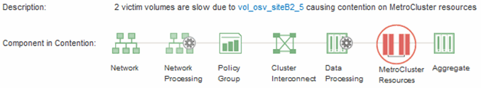
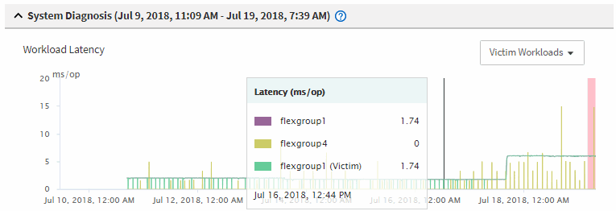

= Active IQ Unified Manager でクラスターの MetroCluster パフォーマンスイベントを分析する
:allow-uri-read: 
:icons: font
:imagesdir: ../media/

[role="lead"]
Unified Managerを使用して、パフォーマンス イベントが検出されたMetroCluster構成のクラスタについて分析することができます。クラスター名、イベント検出時刻、および_bully_と_victim_のワークロードを特定できます。

.開始する前に
* オペレータ、アプリケーション管理者、またはストレージ管理者のロールが必要です。
* MetroCluster構成についての新規、確認済み、または廃止のパフォーマンス イベントが検出されている必要があります。
* MetroCluster構成の両方のクラスタをUnified Managerの同じインスタンスで監視している必要があります。

.手順
. イベントに関する情報を表示するには、「イベントの詳細」ページを表示します。
. イベントの説明を参照して、関連するワークロードの名前と数を確認します。
+
この例では、[MetroCluster Resources]アイコンが赤色で表示されており、MetroClusterのリソースが競合状態にあることがわかります。アイコンにカーソルを合わせると、アイコンの説明が表示されます。

+

. クラスタの名前とイベントの検出時刻を書き留めます。この情報は、パートナー クラスタのパフォーマンス イベントを分析するときに使用します。
. グラフで、_victim_ ワークロードを確認し、応答時間がパフォーマンスしきい値を超えていることを確認します。
+
この例では、マウスオーバーで表示される情報にVictimワークロードが表示されています。[レイテンシ]グラフを確認すると、関連するVictimワークロードの全体的なレイテンシのパターンは一貫していることがわかります。Victimワークロードの異常なレイテンシによってイベントがトリガーされた場合でも、レイテンシのパターンが一貫していれば、ワークロードのパフォーマンスは想定範囲内に収まっており、I/Oの一時的な上昇によってレイテンシが増加したことでイベントがトリガーされた可能性が考えられます。

+

+
これらのボリュームのワークロードにアクセスするアプリケーションでクライアントに最近インストールしたものがある場合は、そのアプリケーションから大量のI/Oが送信されたことが原因でレイテンシが増加した可能性があります。ワークロードのレイテンシが想定範囲内に戻ってイベントの状態が廃止に変わり、その状態が30分以上続くようであれば、このイベントは無視しても問題がないと考えられます。イベントが新規の状態のまま継続する場合は、イベントの原因となった問題が他にないかどうかをさらに詳しく調べます。

. ワークロードスループットチャートで、*Bully Workloads* を選択すると、過負荷ワークロードが表示されます。
+
Bullyワークロードがある場合は、ローカル クラスタの1つ以上のワークロードがMetroClusterのリソースを過剰に消費しているためにイベントが発生した可能性が考えられます。Bullyワークロードの書き込みスループット（MBps）の偏差が大きくなっています。

+
このグラフから、ワークロードの全体的な書き込みスループット（MBps）のパターンがわかります。書き込みMBpsのパターンからスループットの異常が認められるため、ワークロードがMetroClusterのリソースを過剰に使用している可能性があります。

+
イベントに関連するBullyワークロードがない場合は、クラスタ間のリンクの健常性の問題やパートナー クラスタのパフォーマンスの問題がイベントの原因として考えられます。Unified Managerを使用してMetroCluster構成の両方のクラスタの健常性を確認できます。また、パートナー クラスタのパフォーマンス イベントの確認と分析もUnified Managerで実行できます。

