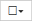

= Active IQ Unified Manager でストレージオブジェクトにパフォーマンスしきい値ポリシーを割り当てる
:allow-uri-read: 
:icons: font
:imagesdir: ../media/

[role="lead"]
パフォーマンス カウンタの値がポリシーの設定を超えたときにUnified Managerからイベントが報告されるように、ストレージ オブジェクトにユーザ定義のパフォーマンスしきい値ポリシーを割り当てます。

.開始する前に
アプリケーション管理者のロールが必要です。

オブジェクトに適用するパフォーマンスしきい値ポリシーを用意しておく必要があります。

パフォーマンス ポリシーは、オブジェクトまたはオブジェクトのグループに一度に1つずつ適用できます。

ストレージ オブジェクトごとに最大3つのしきい値ポリシーを割り当てることができます。複数のオブジェクトにポリシーを割り当てる際に、ポリシーがすでに上限まで割り当てられたオブジェクトが含まれていると、Unified Managerでは次のように処理されます。

* 選択したオブジェクトのうち、ポリシーの数が上限に達していないすべてのオブジェクトにポリシーが適用されます。
* ポリシーの数が上限に達しているオブジェクトは無視されます。
* 一部のオブジェクトにポリシーが割り当てられなかったことを示すメッセージが表示されます。

.手順
. いずれかのストレージ オブジェクトの[パフォーマンス]インベントリ ページで、しきい値ポリシーを割り当てるオブジェクトを選択します。
+
|===
| しきい値を割り当てる対象 | 操作 

 a| 
単一のオブジェクト
 a| 
そのオブジェクトの左にあるチェック ボックスをオンにします。

 a| 
複数のオブジェクト
 a| 
各オブジェクトの左にあるチェック ボックスをオンにします。

 a| 
ページに表示されたすべてのオブジェクト
 a| 
ドロップダウンボックスを開き、「このページ上のすべてのオブジェクトを選択」を選択します。

 a| 
同じタイプのすべてのオブジェクト
 a| 
のドロップダウンボックスを開き、「すべてのオブジェクトを選択」を選択します。

|===
+
ソートやフィルタの機能を使用してインベントリ ページに表示されるオブジェクトのリストを絞り込むと、複数のオブジェクトにしきい値ポリシーを簡単に適用できます。

. 選択後、*パフォーマンスしきい値ポリシーの割り当て*をクリックします。
+
[パフォーマンスしきい値ポリシーの割り当て]ページが表示され、そのタイプのストレージ オブジェクトに対応するしきい値ポリシーのリストが表示されます。

. 各ポリシーをクリックしてパフォーマンスしきい値設定の詳細を表示し、正しいしきい値ポリシーが選択されていることを確認します。
. 適切なしきい値ポリシーを選択したら、*ポリシーの割り当て*をクリックしてください。
+
しきい値ポリシーがオブジェクトに割り当てられたことを示すメッセージがページの上部に表示されます。このオブジェクトとポリシーに対するアラートを設定できるように、[アラート]ページへのリンクも表示されます。

特定のパフォーマンス イベントが生成されたときにEメールやSNMPトラップでアラートが通知されるようにするには、[アラート セットアップ]ページでアラートを設定する必要があります。
