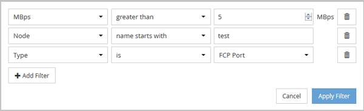
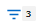

= Active IQ Unified Manager のオブジェクトインベントリパフォーマンスページでデータをフィルタリングする
:allow-uri-read: 
:icons: font
:imagesdir: ../media/

[role="lead"]
[オブジェクト インベントリ パフォーマンス]ページでデータをフィルタリングし、特定の条件に基づいてデータをすばやく特定できます。フィルタリングを使用すると、[オブジェクト インベントリ パフォーマンス]ページの内容を絞り込んで、指定した結果だけを表示できます。そのため、関心のあるパフォーマンス データだけを効率的に表示できます。

[フィルタ]パネルを使用して、グリッド ビューをカスタマイズできます。使用可能なフィルタ オプションは、グリッドで表示しているオブジェクト タイプによって異なります。現在フィルターが適用されている場合、適用されているフィルターの数がフィルターボタンの右側に表示されます。

次の3種類のフィルタ パラメータがサポートされています。

|===
| パラメータ | 検証 

 a| 
文字列（テキスト）
 a| 
演算子は、*含む*、*で始まる*、*で終わる*、*含まない*です。

 a| 
数値
 a| 
演算子は、*greater than*、*less than*、*in the last*、*between* です。

 a| 
列挙（テキスト）
 a| 
演算子は「is」と「is not」です。

|===
それぞれのフィルタに、[列]、[演算子]、[値]の各フィールドが必要です。使用可能なフィルタは、現在のページのフィルタ可能な列に基づいて決まります。適用できるフィルタは4つまでです。フィルタ パラメータの組み合わせに基づいてフィルタされた結果が表示されます。フィルタされた結果は、現在表示しているページだけでなく、フィルタで検索するすべてのページに適用されます。

フィルタは[フィルタ]パネルで追加できます。

. ページ上部の「フィルター」ボタンをクリックします。フィルタリングパネルが表示されます。
. 左側のドロップダウンリストをクリックしてオブジェクトを選択します。たとえば、_Cluster_ やパフォーマンスカウンターなどです。
. 中央のドロップダウン リストをクリックし、使用する演算子を選択します。
. 最後のリストで、値を選択または入力してそのオブジェクトのフィルタを完成させます。
. 別のフィルターを追加するには、「+Add Filter」をクリックしてください。追加のフィルターフィールドが表示されます。前述の手順に従って、このフィルターを完成させてください。4つ目のフィルターを追加すると、「+Add Filter」ボタンが表示されなくなることに注意してください。
. *フィルターを適用*をクリックします。フィルターオプションがグリッドに適用され、フィルターの数がフィルターボタンの右側に表示されます。
. 個々のフィルタを削除するには、[フィルタ]パネルで、削除するフィルタの右にあるごみ箱のアイコンをクリックします。
. すべてのフィルターを解除するには、フィルタリングパネルの下部にある「Reset」をクリックしてください。

[[filtering-example]]
== フィルタリングの例

この図は、3つのフィルターが表示されたフィルタリングパネルを示しています。「+Add Filter」ボタンは、フィルターの数が最大4つ未満の場合に表示されます。

*「フィルターを適用」*をクリックすると、フィルターパネルが閉じ、フィルターが適用され、適用されたフィルターの数が表示されます（）。
