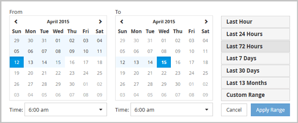

= Active IQ Unified Manager でカスタム時間範囲を指定する
:allow-uri-read: 
:icons: font
:imagesdir: ../media/

[role="lead"]
[パフォーマンス エクスプローラ]ページを使用して、パフォーマンス データの期間を指定できます。カスタムの期間を指定すると、クラスタ オブジェクトのデータを絞り込む際に、事前定義の期間を使用するよりも柔軟に設定できます。

期間は1時間から390日の間で選択できます。13ヶ月は390日です。各月は30日として計算されます。日付と時間範囲を指定すると、より詳細な情報が得られ、特定のパフォーマンスイベントや一連のイベントに絞り込んで分析することができます。時間範囲を指定することで、潜在的なパフォーマンス問題のトラブルシューティングにも役立ちます。日付と時間範囲を指定すると、パフォーマンスイベント周辺のデータがより詳細に表示されます。「Time Range」コントロールを使用して、定義済みの日付と時間範囲を選択するか、最大390日間のカスタム日付と時間範囲を指定できます。定義済みの時間範囲に対応するボタンは、「Last Hour」から「Last 13 Months」まで用意されています。

「過去13か月」オプションを選択するか、30日を超えるカスタム日付範囲を指定すると、30日を超える期間のパフォーマンスデータは5分間隔のデータポーリングではなく、1時間ごとの平均値を使用してグラフ化されていることを知らせるダイアログボックスが表示されます。そのため、タイムラインの視覚的な粒度が低下する可能性があります。ダイアログボックスで「次回から表示しない」オプションをクリックすると、「過去13か月」オプションを選択した場合、または30日を超えるカスタム日付範囲を指定した場合に、メッセージは表示されなくなります。要約データは、より短い期間にも適用されます。ただし、その期間に今日から30日以上前の日時が含まれる場合に限ります。

選択した期間（カスタムまたは事前定義）が30日以内の場合、5分ごとのデータ サンプルに基づいてデータが表示されます。30日を超える場合は、1時間ごとのデータ サンプルに基づいてデータが表示されます。

. *Time Range* ドロップダウンボックスをクリックすると、Time Range パネルが表示されます。
. あらかじめ定義された時間範囲を選択するには、「Time Range」パネルの右側にある「Last…」ボタンのいずれかをクリックします。あらかじめ定義された期間を選択した場合、最大13か月分のデータが利用可能です。選択した事前定義済みの時間範囲ボタンがハイライト表示され、カレンダーと時間選択ツールに該当する日付と時刻が表示されます。
. カスタムの日付範囲を選択するには、左側の *From* カレンダーで開始日をクリックします。*<* or *>* をクリックして、カレンダーを前後に移動します。終了日を指定するには、右側の *To* カレンダーで日付をクリックします。終了日を指定しない限り、デフォルトの終了日は本日となります。時間範囲パネルの右側にある *カスタム範囲* ボタンがハイライト表示されており、カスタムの日付範囲が選択されたことを示しています。
. カスタムの時間範囲を選択するには、*From* カレンダーの下にある *Time* コントロールをクリックし、開始時間を選択します。終了時刻を指定するには、右側の *To* カレンダーの下にある *Time* コントロールをクリックし、終了時刻を選択します。時間範囲パネルの右側にある *Custom Range* ボタンがハイライト表示されています。これは、カスタム時間範囲が選択されたことを示しています。
. 必要に応じて、あらかじめ定義された日付範囲を選択する際に、開始時刻と終了時刻を指定できます。前述のように、あらかじめ定義された日付範囲を選択し、次に前述のように開始時刻と終了時刻を選択します。選択した日付はカレンダー上でハイライト表示され、指定した開始時刻と終了時刻が「時間」コントロールに表示され、「カスタム範囲」ボタンがハイライト表示されます。
. 日付と時間範囲を選択したら、*Apply Range* をクリックしてください。その期間のパフォーマンス統計は、グラフとイベントタイムラインに表示されます。

