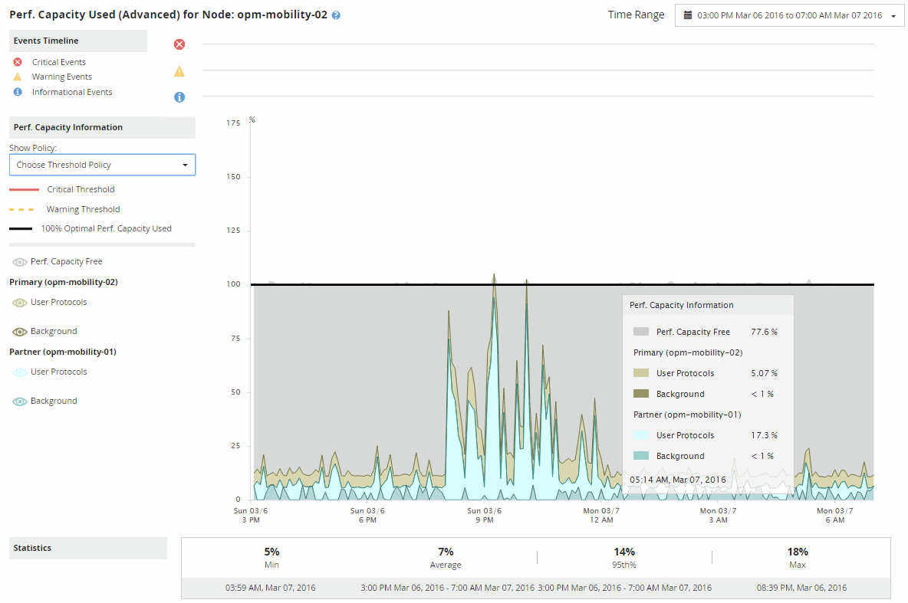

= Active IQ Unified Manager でパフォーマンス容量使用内訳チャートを使用してフェイルオーバー計画を策定する
:allow-uri-read: 
:icons: font
:imagesdir: ../media/

[role="lead"]
[使用済みパフォーマンス容量（内訳）]グラフには、プライマリ ノードとパートナー ノードの使用済みパフォーマンス容量が表示されます。また、推定テイクオーバー ノードの空きパフォーマンス容量も表示されます。この情報から、パートナー ノードで障害が発生した場合にパフォーマンスの問題が生じる可能性があるかどうかを判断できます。

内訳グラフでは、ノードの使用済みパフォーマンス容量の合計に加えて、各ノードの値がユーザ プロトコルとバックグラウンド プロセスに分けて表示されます。

* ユーザ プロトコルは、ユーザ アプリケーションとクラスタとの間のI/O処理です。
* バックグラウンド プロセスは、ストレージ効率化、データ レプリケーション、およびシステム健全性に関連する内部システム プロセスです。

これらの詳細情報を確認することにより、パフォーマンスの問題の原因がユーザ アプリケーションのアクティビティとバックグラウンドのシステム プロセス（重複排除、RAIDの再構築、ディスク スクラビング、SnapMirrorコピーなど）のどちらにあるかを判断できます。

.手順
. 推定テイクオーバーノードとして機能するノードの「Performance/Node Failover Planning」ページに移動してください。
. 「時間範囲」セレクターから、カウンターグリッドとカウンターチャートに履歴統計を表示する期間を選択します。
+
カウンタ グラフにプライマリ ノード、パートナー ノード、推定テイクオーバー ノードの統計が表示されます。

. 「チャートの選択」リストから「パフォーマンス。使用容量」を選択します。
. *Perf.使用容量*チャートで、「内訳」を選択し、「ズーム表示」をクリックします。
+
[使用済みパフォーマンス容量]の詳細グラフが表示されます。

+

. 詳細グラフにカーソルを合わせて、ポップアップ ウィンドウに表示される使用済みパフォーマンス容量の情報を確認します。
+
[空きパフォーマンス容量]の割合は、推定テイクオーバー ノードで使用可能なパフォーマンス容量です。これは、フェイルオーバー後にテイクオーバー ノードに残っているパフォーマンス容量を示します。0%の場合は、フェイルオーバーによってテイクオーバー ノードのレイテンシが許容できないレベルまで増加します。

. その場合、空きパフォーマンス容量の割合の低下を回避するための対処を検討します。
+
ノードのメンテナンスのためにフェイルオーバーを予定している場合は、空きパフォーマンス容量の割合が0でない時間帯にパートナー ノードを停止するようにします。

