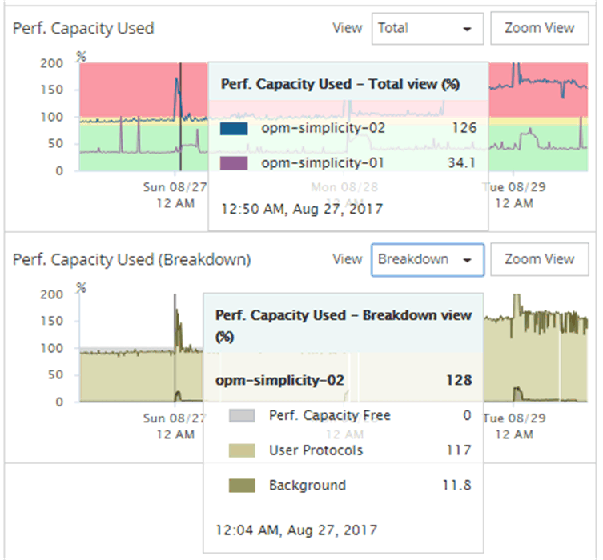

= Active IQ Unified Manager でパフォーマンス容量カウンターチャートを表示する
:allow-uri-read: 
:icons: font
:imagesdir: ../media/

[role="lead"]
[パフォーマンス エクスプローラ]ページには、ノードとアグリゲートの使用済みパフォーマンス容量グラフを表示できます。選択したノードとアグリゲートの特定の期間にわたる詳細なパフォーマンス容量データを確認できます。

標準のカウンタ グラフには、選択したノードまたはアグリゲートの使用済みパフォーマンス容量の値が表示されます。内訳カウンタ グラフには、ルート オブジェクトのパフォーマンス容量の値の合計が、ユーザ プロトコルとバックグラウンドのシステム プロセスに分けて表示されます。また、空きパフォーマンス容量も表示されます。

[NOTE]
====
システムとデータの管理に関連する一部のバックグラウンド アクティビティはユーザ ワークロードとみなされ、ユーザ プロトコルに分類されるため、これらのプロセスの実行時にはユーザ プロトコルの割合が一時的に高く見えることがあります。通常、これらのプロセスはクラスタの使用量が少ない午前0時頃に実行されます。ユーザ プロトコルのアクティビティが午前0時頃に急増している場合は、その時間にクラスタのバックアップ ジョブまたはその他のバックグラウンド アクティビティの実行が設定されていないかどうかを確認してください。

====
.手順
. ノードまたはアグリゲートの「ランディング」ページから「エクスプローラー」タブを選択します。
. 「カウンターチャート」ペインで、「チャートの選択」をクリックし、「パフォーマンス容量使用済み」チャートを選択します。
. グラフが表示されるまで下にスクロールします。
+
標準グラフには、最適な範囲内のオブジェクトは黄色、利用率が低いオブジェクトは緑、利用率が高いオブジェクトは赤で表示されます。内訳グラフには、ルート オブジェクトについてのみパフォーマンス容量の詳細が表示されます。

+

. どちらかのグラフをフルサイズで表示する場合は、*ズーム表示*をクリックしてください。
+
このようにして複数のカウンタ グラフを別々のウィンドウで開くことで、使用済みパフォーマンス容量の値を同じ期間のIOPSまたはMBpsの値と比較できます。

