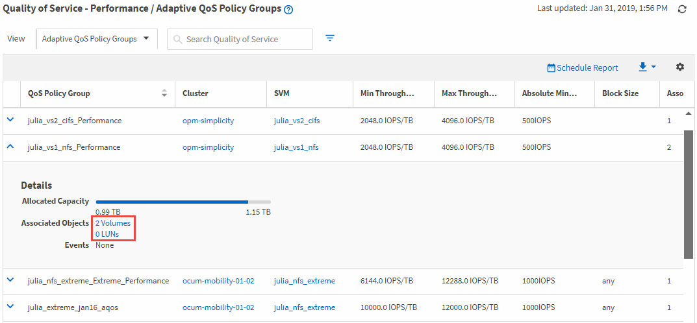

= Active IQ Unified Manager で同じ QoS ポリシーグループ内のボリュームまたは LUN を表示する
:allow-uri-read: 
:icons: font
:imagesdir: ../media/

[role="lead"]
同じQoSポリシー グループに割り当てられているボリュームおよびLUNのリストを表示できます。

複数のボリューム間で「`shared`」される従来のQoSポリシーグループの場合、特定のボリュームがポリシーグループに定義されたスループットを過剰に使用しているかどうかを確認するのに役立ちます。また、他のボリュームに悪影響を与えることなく、ポリシーグループに他のボリュームを追加できるかどうかを判断するのにも役立ちます。

アダプティブQoSポリシーとUnified Managerのパフォーマンス サービス レベル ポリシーでは、ポリシー グループを使用しているすべてのボリュームまたはLUNを表示して、QoSポリシーの設定を変更した場合に影響を受けるオブジェクトを確認できます。

.手順
. 左側のナビゲーションペインで、*ストレージ* > *QoS ポリシーグループ*をクリックします。
+
デフォルトでは、「パフォーマンス：従来の QoS ポリシーグループ」ビューが表示されます。

. 従来のポリシー グループを対象とする場合は、このページを表示したままにします。それ以外の場合は、その他のいずれかの[表示]オプションを選択して、アダプティブQoSポリシー グループまたはUnified Managerのパフォーマンス サービス レベルで作成されたQoSポリシー グループをすべて表示します。
. 関心のある QoS ポリシーで、QoS ポリシーグループ名の横にある展開ボタン（）をクリックして詳細を表示します。
. [ボリューム]リンクまたは[LUN]リンクをクリックして、このQoSポリシーを使用しているオブジェクトを表示します。
+
ボリュームまたはLUNの[パフォーマンス]インベントリ ページに、QoSポリシーを使用しているオブジェクトのリストが表示されます。

