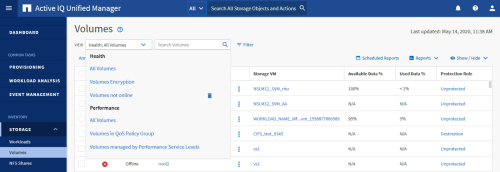

= Active IQ Unified Manager におけるビューとレポートの関係を理解する
:allow-uri-read: 
:icons: font
:imagesdir: ../media/

[role="lead"]
ビューおよびインベントリ ページをダウンロードまたはスケジュール設定したものがレポートです。

ビューとインベントリ ページはカスタマイズして保存し、再利用することができます。Unified Managerで表示できるほぼすべての情報を、レポートとして保存、再利用、カスタマイズ、スケジュール設定、共有できます。

[表示]ドロップダウンで削除アイコンのある項目は、自分または他のユーザが作成した既存のカスタム ビューです。アイコンのない項目は、Unified Managerのデフォルト ビューです。デフォルト ビューを変更または削除することはできません。

[NOTE]
====
* リストからカスタム ビューを削除すると、そのビューを使用するExcelファイルまたはスケジュール済みレポートもすべて削除されます。
* カスタム ビューを変更した場合、そのビューを使用するレポートに変更が反映されるのは、レポート スケジュールに従って次回レポートが生成されてEメールで送信されるときです。ビューを変更する場合は、変更内容がExcelで行ったレポートのカスタマイズに対応することを確認してください。必要であれば、Excelファイルをダウンロードして必要な変更を加え、ビューに対して再度アップロードすれば、Excelファイルを更新できます。

====

削除アイコンが表示され、ビューやスケジュール済みレポートを変更したり削除したりできるのは、アプリケーション管理者ロールまたはストレージ管理者ロールのユーザだけです。
