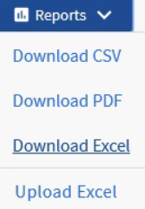
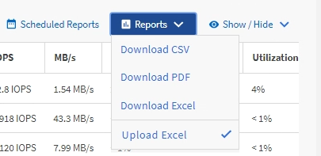

= Active IQ Unified Manager で使用可能な IOPS が最も多いアグリゲートを表示するレポートを作成する
:allow-uri-read: 
:icons: font
:imagesdir: ../media/

[role="lead"]
このレポートは、使用可能なIOPSが最も多く、新しいワークロードをプロビジョニング可能なアグリゲートをアグリゲート タイプ別に表示します。

.開始する前に
* アプリケーション管理者またはストレージ管理者のロールが必要です。

以下の手順に従って、「ヘルス：すべてのボリューム」ビューを開き、ビューをExcelでダウンロードし、空き容量のグラフを作成し、カスタマイズしたExcelファイルをアップロードして、最終レポートのスケジュールを設定します。

.手順
. 左側のナビゲーションペインで、*ストレージ*>*アグリゲート*をクリックします。
. 「表示」ドロップダウンから「パフォーマンス：すべてのアグリゲート」を選択します。
. *Show/Hide*を選択して `Available IOPS`列を表示し、 `Cluster FQDN, Inactive Data Reporting,`および `Threshold Policy`列を非表示にします。
.  `Available IOPS` および  `Free Capacity` 列をドラッグして、 `Type` 列の横にドロップします。
. カスタムビューに名前を付けて保存する `Available IOPS Per Aggr.`
. *レポート* > *Excelをダウンロード*を選択します。
+

+
お使いのブラウザによっては、ファイルを保存するために「OK」をクリックする必要がある場合があります。

. 必要に応じて、*編集を有効にする*をクリックしてください。
. ダウンロードしたファイルをExcelで開きます。
. dataシートの左上にある小さい三角形をクリックして、シート全体を選択します。
. *データ* リボンで、 `Sort & Filter area.`から *並べ替え* を選択します
. 次の並べ替えレベルを設定します。
+
.. *Sort by*を `Available IOPS`（IOPS）に、*Sort On*を `Cell Values,`に、*Order*を `Largest to Smallest.`に指定します。
.. *レベルを追加*をクリックします。
.. *Sort by*を `Type`、*Sort On*を `Cell Values,`、*Order*を `Z to A.`に指定します。
.. *レベルを追加*をクリックします。
.. *並べ替え*を `Free Capacity (GB),`、*並べ替えの基準*を `Cell Values,`、*順序*を `Largest to Smallest.`に指定します。
.. *OK*をクリックします。

. Excelファイルを保存して、閉じます。
. Unified Managerで、*レポート* > *Excelファイルのアップロード*を選択します。
+
[NOTE]
====
Excelファイルをダウンロードしたときと同じビューが表示されていることを確認してください。

====
. 変更したExcelファイル、この場合は `performance-aggregates-<date>.xlsx.`を選択します
. *Open*をクリックします。
. 「送信」をクリックしてください。
+
*レポート* > *Excelのアップロード* メニュー項目の横にチェックマークが表示されます。

+

. *スケジュール済みレポート*をクリックします。
. *スケジュールを追加*をクリックして、レポートスケジュールページに新しい行を追加し、新しいレポートのスケジュール特性を定義できるようにします。
. レポートスケジュールの名前を入力し、その他のレポートフィールドへの入力を完了したら、行の最後にあるチェックマーク（image:../media/blue_check.gif[""]）をクリックします。
+
[NOTE]
====
レポートの形式として*XLSX*を選択してください。

====
+
テスト レポートがすぐに送信されます。以降、指定した頻度でレポートが生成され、リスト内の受信者にEメールで送信されます。

レポートに表示された結果を基に、使用可能なIOPSが最も多いアグリゲートに新しいワークロードをプロビジョニングできます。
