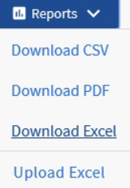
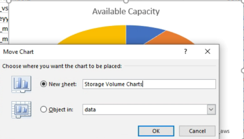
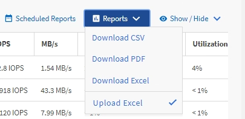

= Active IQ Unified Manager で利用可能なボリューム容量チャートを表示するレポートを作成する
:allow-uri-read: 
:icons: font
:imagesdir: ../media/

[role="lead"]
使用可能なボリューム容量を分析するためのExcelグラフ形式のレポートを作成できます。

.開始する前に
* アプリケーション管理者またはストレージ管理者のロールが必要です。

以下の手順に従って、「ヘルス：すべてのボリューム」ビューを開き、ビューをExcelでダウンロードし、空き容量のグラフを作成し、カスタマイズしたExcelファイルをアップロードして、最終レポートのスケジュールを設定します。

.手順
. 左側のナビゲーションペインで、*ストレージ* ＞ *ボリューム* をクリックします。
. *レポート* > *Excelをダウンロード*を選択します。
+

+
お使いのブラウザによっては、ファイルを保存するために「OK」をクリックする必要がある場合があります。

. 必要に応じて、*編集を有効にする*をクリックしてください。
. ダウンロードしたファイルをExcelで開きます。
.  `data`シートで、 `Volume`および `Available Data`%列で使用するデータを選択します。
. 「挿入」メニューで、 `3-D piechart.`
+
使用可能なスペースが最も多いボリュームがグラフに表示されます。グラフがdataシートに表示されます。

+
[NOTE]
====
ネットワーク設定によっては、列全体を選択したり、選択したデータ行が多すぎると、円グラフが読めなくなることがあります。このサンプルでは3-D円グラフを使用していますが、任意のグラフ タイプを使用できます。キャプチャするデータが適切に表示されるグラフを使用してください。

====
. グラフのタイトルを*利用可能な容量*とします。
. グラフを右クリックして、*Move Chart*を選択します。
. *新規シート*を選択し、シート名を*Storage Volume Charts*にします。
+
[NOTE]
====
infoシートとdataシートのあとに新しいシートが表示されることを確認してください。

====
+

. グラフを選択すると表示される「デザイン」メニューと「書式」メニューを使用すると、グラフの外観をカスタマイズできます。
. 問題がなければ、変更したファイルを保存します。
. Unified Managerで、*レポート* > *Excelファイルのアップロード*を選択します。
+
[NOTE]
====
Excelファイルをダウンロードしたときと同じビューが表示されていることを確認してください。

====
. 変更したExcelファイルを選択します。
. *Open*をクリックします。
. 「送信」をクリックしてください。
+
*レポート* > *Excelのアップロード* メニュー項目の横にチェックマークが表示されます。

+

. *スケジュール済みレポート*をクリックします。
. *スケジュールの追加*をクリックして、*レポートスケジュール*ページに新しい行を追加し、新しいレポートのスケジュール特性を定義します。
. レポートスケジュールの名前を入力し、その他のレポートフィールドへの入力を完了したら、行の最後にあるチェックマーク（image:../media/blue_check.gif[""]）をクリックします。
+
[NOTE]
====
レポートの形式として*XLSX*を選択してください。

====
+
テスト レポートがすぐに送信されます。以降、指定した頻度でレポートが生成され、リスト内の受信者にEメールで送信されます。

レポートに表示された結果を基に、ボリュームの負荷を分散できます。
