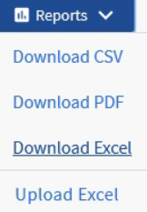
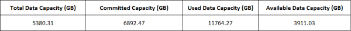
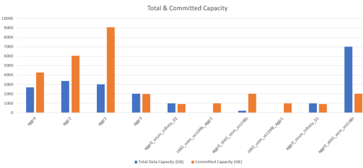
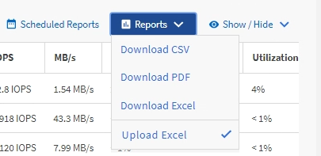

= Active IQ Unified Manager でアグリゲート容量のテーブルとグラフを表示するレポートを作成する
:allow-uri-read: 
:icons: font
:imagesdir: ../media/

[role="lead"]
合計および集合縦棒グラフ形式を使用して、容量を分析するためのレポートをExcelファイルで作成できます。

.開始する前に
* アプリケーション管理者またはストレージ管理者のロールが必要です。

次の手順に従って、「健全性：すべてのアグリゲート」ビューを開き、ビューを Excel 形式でダウンロードし、使用可能容量チャートを作成し、カスタマイズした Excel ファイルをアップロードして、最終レポートをスケジュールします。

.手順
. 左側のナビゲーションペインで、*ストレージ*>*アグリゲート*をクリックします。
. *レポート* > *Excelをダウンロード*を選択します。
+

+
お使いのブラウザによっては、ファイルを保存するために「OK」をクリックする必要がある場合があります。

. 必要に応じて、*編集を有効にする*をクリックしてください。
. ダウンロードしたファイルをExcelで開きます。
.  `data`シートの後に新しいシート（）を作成し、*Total Data Capacity* という名前を付けます。
. 作成したTotal Data Capacityシートに次の列を追加します。
+
.. 合計データ容量（GB）
.. コミット済み容量（GB）
.. 使用済みデータ容量（GB）
.. 使用可能なデータ容量（GB）

. 各列の最初の行に、次の式を入力します。必ず、dataシート（data!）を参照し、キャプチャされたデータの正しい列と行を参照してください（Total Data CapacityはE列の2～20行目からデータを取得します）。
+
.. =SUM(data!E$2:data!E$20)
.. =SUM(data!F$2:data!F$50)
.. =SUM(data!G$2:data!G$50)
.. =SUM(data!H$2:data!H$50)

+
この式は、現在のデータに基づいて各列の値を合計します。

. データシートで、*総データ容量（GB）*と*コミット済み容量（GB）*の列を選択します。
. *「挿入」*メニューから*「推奨グラフ」*を選択し、*「集合縦棒」*グラフを選択します。
. チャートを右クリックして「チャートの移動」を選択し、チャートを `Total Data Capacity`シートに移動します。
. グラフを選択すると表示される「デザイン」メニューと「書式」メニューを使用すると、グラフの外観をカスタマイズできます。
. 問題がなければ、変更したファイルを保存します。ファイルの名前や場所は変更しないでください。
+

. Unified Managerで、*レポート* > *Excelファイルのアップロード*を選択します。
+
[NOTE]
====
Excelファイルをダウンロードしたときと同じビューが表示されていることを確認してください。

====
. 変更したExcelファイルを選択します。
. *Open*をクリックします。
. 「送信」をクリックしてください。
+
*レポート* > *Excelのアップロード* メニュー項目の横にチェックマークが表示されます。

+

. *スケジュール済みレポート*をクリックします。
. *スケジュールを追加*をクリックして、レポートスケジュールページに新しい行を追加し、新しいレポートのスケジュール特性を定義できるようにします。
+
[NOTE]
====
レポートの形式として*XLSX*を選択してください。

====
. レポートスケジュールの名前を入力し、その他のレポートフィールドへの入力を完了したら、行の最後にあるチェックマーク（image:../media/blue_check.gif[""]）をクリックします。
+
テスト レポートがすぐに送信されます。以降、指定した頻度でレポートが生成され、リスト内の受信者にEメールで送信されます。

レポートに表示された結果を基に、どうすればネットワーク全体で使用可能容量を有効に利用できるかを調べることができます。
