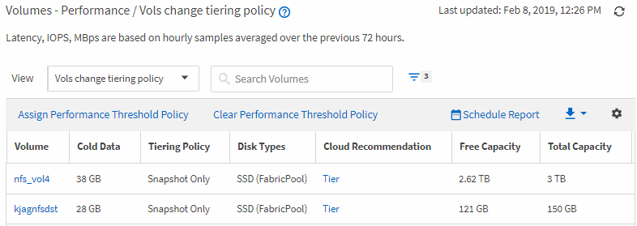

= Active IQ Unified Manager でクラウド層にデータを移動する必要があるボリュームを特定します
:allow-uri-read: 
:icons: font
:imagesdir: ../media/

[role="lead"]
現在FabricPoolアグリゲートにあってクラウド階層に関する推奨事項があり、さらに大量のコールド データがあるボリュームのリストを記載したレポートを作成できます。このレポートは、特定のボリュームの階層化ポリシーを「`auto`」または「`all`」に変更して、より多くのコールド（非アクティブ）データをクラウド階層にオフロードすべきかどうかを判断するのに役立ちます。

.開始する前に
* アプリケーション管理者またはストレージ管理者のロールが必要です。
* FabricPoolアグリゲートを設定しておく必要があります。また、それらのアグリゲート上にボリュームが必要です。

次の手順を実行して、必要な列を正しい順序で表示するカスタム ビューを作成し、そのビューのレポートを生成するようにスケジュール設定します。

.手順
. 左側のナビゲーションペインで、*ストレージ* ＞ *ボリューム* をクリックします。
. 「表示」メニューで、「パフォーマンス」＞「すべてのボリューム」を選択します。
. 列選択画面で、「`Disk Type`」列が表示されていることを確認してください。
+
他の列を追加または削除して、レポートにとって重要なビューを作成します。

. 「`Disk Type`」列を「`Cloud Recommendation`」列の近くにドラッグアンドドロップします。
. フィルターアイコンをクリックし、以下の3つのフィルターを追加してから、*フィルターを適用*をクリックします。
+
** ディスクの種類にFabricPoolが含まれる
** クラウドに関する推奨事項に階層が含まれる
** 10 GBを超えるコールドデータimage:../media/filter_cold_data.gif["フィルターを追加して適用する方法を示すUIスクリーンショット。"]

. [コールド データ]列の上部をクリックして、コールド データの量が最も多いボリュームがビューの先頭に表示されるようにします。
. ビューの内容を反映した名前を付けて保存します。例：「`Vols change tiering policy`」
. インベントリページの「スケジュール済みレポート」ボタンをクリックします。
. *スケジュールを追加*をクリックして、レポートスケジュールページに新しい行を追加し、新しいレポートのスケジュール特性を定義できるようにします。
. レポートスケジュールの名前を入力し、その他のレポートフィールドへの入力を完了したら、行の最後にあるチェックマーク（image:../media/blue_check.gif[""]）をクリックします。
+
テスト レポートがすぐに送信されます。以降、指定した頻度でレポートが生成され、リスト内の受信者にEメールで送信されます。

レポートに示された結果に基づいて、System ManagerまたはONTAP CLIを使用して、特定のボリュームの階層化ポリシーを「`auto`」または「`all`」に変更し、より多くのコールドデータをクラウド階層にオフロードすることをお勧めします。
